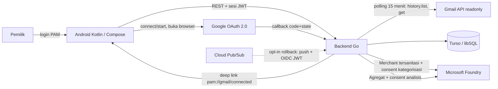

# PAM — Personal Finance Android App

PAM mengubah notifikasi email **Livin by Mandiri** dan transaksi manual menjadi
rekap arus kas bulanan. Pengguna dapat meninjau kategori, meminta bantuan kategorisasi
Azure, dan mengakses analisis serta perencanaan anggaran sesuai consent masing-masing.

**Status:** dalam pengembangan · **Sprint aktif:** S2 / PARTIAL
**Pembaruan dokumentasi:** 24 November 2026 · **Branch kerja:** `feat/c2-android`
**SRS resmi:** v0.5 · **Release/merge/deploy:** belum dinyatakan selesai

> README ini adalah pintu masuk proyek. Riwayat pekerjaan, hasil tes, dan gate yang belum
> lulus dibedakan; commit atau jumlah tes tidak otomatis membuktikan fitur selesai.
> **Snapshot gate Gmail/retensi 24 November 2026:** Android HEAD `51985f3` (kode app `e67380a`;
> fresh **678 tes/88 suite/0 gagal**, lint **0 error/123 warning/1 hint**, APK debug
> **47.992.939 byte**, sha256 `5368c92f…` — build UAT ronde 7 dengan Web OAuth client ID owner),
> backend `integration/2026-11-24` HEAD `00bb515` (kode `c69cf57`; vet/build/test/race PASS),
> kontrak polling §9 **QA E2E 82/82 PASS** diulang pada `00bb515` (fake provider) dan **UAT
> perangkat FIXTURE PASS**. **Gmail live (G25) PASS untuk akun pilot owner** — data 914 transaksi
> dihasilkan runtime build `c98527b` (parser `5df6be6`/`c98527b`; 0 duplikat); **GCP Rp0
> (G29/G37)** tetap **OPEN** dan **SSO live (G36)** + tombol Run Android Studio literal tetap
> **NOT RUN** (instalasi UAT via `adb install -r`). Snapshot APK lama (`7efc1803…`, `8ce4763c…`,
> `41584bae…`) hanya riwayat; artefak gate adalah sha256 `5368c92f…`.
> Rincian: [laporan gate akhir](docs/delivery/FINAL_GATES_GMAIL_YEARLY_WORKFLOW_2026-11-24.md).
> Snapshot lama `ce56d9c` + [review recovery PM](docs/reviews/PM_REVIEW_CE56D9C_SYNC_RECOVERY.md)
> tetap menjadi riwayat. Hasil TERLAPOR SE dan WIP yang belum diverifikasi tidak dihitung
> sebagai acceptance penuh.

## Daftar isi

1. [Ringkasan dan batas produk](#1-ringkasan-dan-batas-produk)
2. [Status sprint dan fitur](#2-status-sprint-dan-fitur)
3. [Progres harian](#3-progres-harian)
4. [Arsitektur dan struktur repository](#4-arsitektur-dan-struktur-repository)
5. [Menjalankan proyek lokal](#5-menjalankan-proyek-lokal)
6. [Pengujian dan bukti](#6-pengujian-dan-bukti)
7. [Konfigurasi, data, dan biaya](#7-konfigurasi-data-dan-biaya)
8. [Dokumentasi dan cara berkontribusi](#8-dokumentasi-dan-cara-berkontribusi)

## 1. Ringkasan dan batas produk

| Kebutuhan | Perilaku yang dituju |
|---|---|
| Pencatatan | Impor notifikasi Livin yang didukung parser, serta transaksi manual |
| Rekap | Perhitungan IDR deterministik, kategori, refund dan transfer internal |
| Kategori | Koreksi pengguna dipertahankan; saran AI mempunyai provenance dan status review |
| Pembaruan | Auto-sync Gmail dan antrean kategori terpisah, dengan status yang dapat diperiksa |
| Analisis/anggaran | Analisis berbasis agregat dan rencana anggaran; integrasi UI masih mengikuti gate delivery |

PAM bukan aplikasi bank: tidak menampilkan saldo rekening terverifikasi, memindahkan uang,
atau menjamin semua transaksi bank tercakup oleh email. `COMPLETE` merujuk pada pemrosesan
scope impor, bukan kelengkapan mutasi rekening. Empty, partial, failed, stale dan angka nol
harus tampil sebagai keadaan berbeda.

## 2. Status sprint dan fitur

### Posisi delivery

| Sprint | Cakupan | Status terakhir |
|---|---|---|
| S1 / fondasi | Android awal, auth dan baseline backend | Baseline tersedia; tidak sama dengan kelulusan proyek |
| **S2** | Integrasi Android–Go, impor, classifier, auto-sync, status UI | **PARTIAL — aktif** |
| S3 | CRUDS transaksi/kategori/anggaran dan dynamic fields | Belum lulus gate; sebagian backend tersedia |
| S4 | Lampiran, admin, visual dan cutover varian penilaian | Belum lulus gate |
| S5 | Verifikasi operasional, benchmark, perangkat dan owner UAT | Gate akhir masih terbuka |

Rincian bukti per gate dan sisa pekerjaan pemilik ada di [laporan gate akhir](docs/delivery/FINAL_GATES_GMAIL_YEARLY_WORKFLOW_2026-11-24.md) (38 gate: 29 PASS, 4 PARTIAL, 5 NOT RUN). Langkah penutupan gate tersisa untuk pemilik: [checklist aksi pemilik](docs/delivery/OWNER_ACTION_CHECKLIST_2026-11-24.md).

### Implementasi versus acceptance

| Area | Yang sudah tersedia | Yang masih perlu dibuktikan/diselesaikan |
|---|---|---|
| Auth dan data server | Go, JWT/refresh, transaksi/list/detail/summary, consent dan koreksi kategori | Acceptance gabungan, seluruh CRUDS dan lifecycle sesuai mandat |
| Gmail/Livin | **Gmail API dengan polling default 15 menit** (tanpa Pub/Sub, tanpa `users.watch`): OAuth dari sesi PAM, refresh token terenkripsi, backfill 12 bulan WIB bertahap yang mengalah pada delta, delta `history.list` + recovery cursor 404, antrean sync manual durable (202/429/409/503), dedupe identitas IMAP→Gmail; push + `users.watch` + Pub/Sub hanya **opt-in rollback**; jalur IMAP lama disimpan sebagai rollback | **Gmail live (G25) PASS** untuk akun pilot owner; **GCP Rp0 (G29/G37) OPEN** (Billing masih tertaut) dan kuota/biaya nyata, restricted scope/CASA tetap milik owner. Bukti terkontrol: [QA E2E 82/82](docs/evidence/GMAIL_CONTRACT_E2E_2026-11-24.md) dan [UAT perangkat FIXTURE](docs/evidence/GMAIL_POLLING_UAT_PHONE_2026-11-24.md) |
| Azure classifier | Adapter, ledger/budget, cache, lease/recovery, caseId mapping dan USER override | Benchmark akurasi berlabel manusia; gate integrasi auto-queue |
| Auto-sync / batch | Worker Gmail memproses delta tiap **15 menit** selama backend hidup (app boleh tertutup) + backfill bertahap, satu job kategorisasi logis (5 merchant/permintaan, maks 4 batch/2 jam), antrean target 2 jam | Latensi email→Go→Android pada **Gmail nyata** belum terukur; pada fixture, delta saat app ditutup terbukti (G28). Due window server sudah diuji |
| Status UI | Satu sheet status ringkas (Bahasa Indonesia) dengan panel **"Sinkron server Gmail"** (state, progres bulan, percobaan/keberhasilan terakhir, jadwal berikutnya, tombol "Sinkronkan sekarang" + hitungan mundur saat cooldown), label job sederhana, rentang retensi setahun + label bulan batas, lampu Gmail "belum tertaut/aktif", UI utama 360–412 dp; font 200% + 360 dp diuji di APK final | Walk TalkBack manual dan lebar 393/412 dp di APK final belum diulang; state tidak lagi tertahan "Menghubungkan" (`addc240`), tetapi teks sisa status perangkat lama di panel "Perlu perhatian" masih dicatat sebagai temuan kecil |
| Kelengkapan penilaian | Kontrak 25 aksi dan empat entitas tersedia | S3/S4, lampiran/admin, dynamic fields dan audit Room/SQLCipher |

Temuan auto-sync tidak membuka kembali empat defect classifier lama yang sudah ditutup
pada `746b598`. Rincian implementasi/evidence: [living checkpoint](docs/DELIVERY_S2_S4_CHECKPOINT.md).
Dokumen itu memuat snapshot historis; baca bagian bertanggal terbaru dan keputusan review,
bukan hanya tabel atau hasil tes lama.

## 3. Progres harian

Tanggal memakai **Asia/Jakarta (WIB)**. Tabel berikut direkonstruksi dari Git/checkpoint;
bukan klaim setiap gate telah lulus pada tanggal tersebut.

| Tanggal | Fokus dan hasil utama | Verifikasi / batas bukti | Sisa utama |
|---|---|---|---|
| 19 Nov 2026 | Fondasi Compose/domain, backend awal dan kontrak klien | Riwayat source/test awal tersedia; bukan run ulang saat ini | Integrasi live dan arsitektur berikutnya |
| 20 Nov 2026 | Jalur IMAP/App Password, MIME, perbaikan analisis dan kajian pedoman | Perbaikan/parser fixture tercatat di Git | Integrasi nyata dan migrasi kepatuhan |
| 21 Nov 2026 | Onboarding, kontrak v0.4, migrasi Go dan baseline C1 | Backend lokal/interop dan emulator subset terdokumentasi | C2 Android dan kelengkapan CRUDS |
| 22 Nov 2026 | Parser strict, impor Go, consent, SRS v0.5, setup/runtime Azure | Unit/integration dan smoke berkembang per checkpoint; bukan benchmark | Runtime recovery dan Android acceptance saat itu |
| **23 Nov 2026** | Hari integrasi S2/S3/S4 di `feat/c2-android`: paket P1 recovery, Android acceptance, varian assessment (`99cb3df`), lalu penutupan gap S2–S4 malam: admin C24/C25 (`a512770`), bukti C01 create manual + identitas lost-response (`aa61a7b`), wiring analisis server S2.5 + guard consent (`7337559`); semua paket lewat audit independen; branch tugas/worktree dibersihkan; dokumen merged-head acceptance ditambahkan.; profil UAT Go + Azure + Ollama disamakan dengan Run Android Studio dan aturan agent diperbarui Lanjutan malam: revamp UI sinkronisasi (Ringkasan bersih, judul terpusat, ikon status 48 dp, satu sheet tanpa impor saat dibuka, hasil sama setelah tutup/buka dan minimize) digabung (`9aeea28`) bersama lane kategori (`dda4084`), lalu perbaikan i18n pasca-merge (`a310067`); bukti perangkat merged di [UAT_MERGED_UI_CATEGORY](../evidence/UAT_MERGED_UI_CATEGORY_2026-11-23.md), draf CR_006, matriks/checkpoint diberi addendum.| Android **493 tests/68 class/0 failure** debug + **503 tests/69 class/0 failure** assessment, lint **0 error/115 warning** debug & **0 error/123 warning** assessment, Go test/vet/build/race ok; merged head `7337559`: C01 create UI `POST /v1/transactions` 201 + ringkasan 92/89→93/90, S2.5 CURRENT→STALE→regenerate→CURRENT→dependency-STALE di perangkat, C24/C25 walk teraudit + regresi; APK debug sha256 `6497a406…`, assessment `fa0d224e…`.; build debug sukses, BuildConfig 10.0.2.2:18090, readiness emulator HTTP 200, probe sintetis Ollama HTTP 200 Sebelum fix, lint merged gagal 7 MissingTranslation; setelah `a310067`: debug **509 tests/0 failure**, assessment **519/0**, lint debug **0 error/112 warning**, lint assessment **0 error/120 warning**, assemble debug+assessment PASS (sha256 `0e9169f2…`/`dea936b8…`), Go test/vet/build/race PASS.| **S3 lulus (C01 PASS runtime)**; **S4.1/S4.2/S4.4 lulus** (batas perangkat C24/C25 dan foreground-only assessment dicatat); **S2.5 PASS runtime** (catatan INFO dependency-churn sync); temuan LOW audit tetap follow-up; gate eksternal S5 (mailbox nyata, benchmark, hosting/backup, UAT pemilik, merge/deploy).; smoke UI dari Run Android Studio dan panggilan Azure pada sesi penyelarasan belum dijalankan; **revisi UI sinkronisasi PASS runtime sebagian besar** — bingkai running/progress live, fade label live, TalkBack live, 412 dp+judul panjang, notis nomor referensi detail owner, resume unggahan pending live = PARTIAL/NOT RUN; **alasan kategori tampil PASS runtime** (`classified=0 needsReview=5 failed=0`, 0 panggilan Azure); **kategori AI terklasifikasi pada data owner, precision ≥95%, Buat Analisis via Ollama dengan bulan EMPTY-coverage = NOT RUN**; audit merged awal **FAIL** (lint) lalu diperbaiki.| `e3eeb17`, `94e2f37`, `99cb3df`, `a512770`, `aa61a7b`, `7337559`, plus commit lane di log harian, `9aeea28`, `dda4084`, `a310067`|
| **24 Nov 2026** | P0 nav satu-sumber-bulan + parser Livin `Penerima` + repair label merchant; Analisis UAT beralih ke Azure Foundry; walk lampiran (konflik/retry) dan admin (pencarian live/filter status/SUSPENDED) menutup gap UI C18/C19/C23/C25<br>Draf workflow baru: impor awal setahun, antrean AI hemat, retensi, dan UI Indonesia ringkas.<br>Gmail API OAuth + Pub/Sub ditetapkan sebagai target pengganti IMAP dan [mandat PM](docs/agent-prompts/PROMPT_PM_GMAIL_API_YEARLY_WORKFLOW.md) disusun.<br>Mandat lanjutan ditambah pemisahan backend ke repo 0037 Backend Financial.<br>Google SSO dan onboarding Gmail masuk draf CR-007; implementasi SSO + penautan akun + onboarding Gmail selesai di fixture/unit (`pam-app@e67380a`, backend `71013f5`), sedangkan UAT akun Google nyata dan gate live **NOT RUN** (menunggu input owner: Web Client ID, SHA-1 client Android terdaftar, akun uji). Bukti fixture perangkat (24 Nov): sheet onboarding Gmail + tombol Lewati tampil, sesi tetap aktif, skip persisten setelah restart; kontrak Gmail polling diulang di integrasi (`138b5c3`) **PASS=82**; pemeriksaan kesiapan read-only `scripts/verify/uat_readiness.sh` ditambahkan untuk prasyarat Run. [Rancangan](docs/plans/AUTO_SYNC_CATEGORY_STATUS_PLAN.md#10-google-sso-dan-onboarding-gmail).SRS v0.6 dan prototipe multi-bank siap review. Mandiri lebih dulu, angka kartu berupa jumlah transaksi, dan hosting Go ditargetkan tanpa biaya tambahan. [Rencana](docs/plans/MULTI_BANK_AND_GO_DEPLOYMENT_PLAN.md).<br>[CR-008](docs/changes/CR_008_DRAFT_PRODUCT_SCOPE.md) mencatat keputusan pemilik untuk satu peran USER. Anggaran, lampiran transaksi, dan administrasi keluar dari cakupan produk. Verifikasi pedoman asli dan konsolidasi SRS masih terbuka.<br>Revisi [SRS v0.7](docs/specifications/PAM_SRS_v0.7_Personal_Finance_Draft.pdf) mengonsolidasikan CR-008 dengan satu peran USER dan dua modul CRUDS produk. Word dan PDF 53 halaman lolos pemeriksaan render, daftar isi, diagram, dan ID requirement. Pemetaan D.5/D.6/D.9 dan pendaftaran akun baru masih terbuka. | Test debug 536/74 dan assessment 546/75 lulus (termasuk audit aksesibilitas 3 layar); lint 0 error/112 warning; UAT owner: sync satu job, kategori Azure, detail merchant nama usaha, Buat Analisis 200 tersimpan; bukti UI `ui_split/36`–`38` dan `40`–`42` | Menunggu **Run Android Studio** pemilik untuk varian final dan drill-down-after (S2), sisa bukti UI S4 (C20 konteks, C24 guard, cursor C25), S5 (merge/deploy, backup, benchmark, mailbox produksi); parity repo split: **P1–P7 PASS** (clone bersih backend 167 tes, APK tanpa source server, E2E login/read 2 transaksi, DB 16 migrasi), **P8 PARTIAL** (restore DB/rollback nyata NOT RUN), **P9 NOT RUN** (Gmail API WIP); audit split PASS dengan temuan doc<br>Workflow baru masih draf dan menunggu implementasi serta UAT.<br>Pemisahan backend dimulai: repo backend `NDI05/0037-Backend-Financial` dibuat (privat), 32 commit riwayat backend diekstrak, bootstrap standalone + CI + kontrak Gmail API dipush (`327d876`); source Go, fixture interop, dan Node lama keluar dari tree Android; verifikasi E2E menunggu.<br>Gmail UI OAuth (branch `feat/gmail-ui`, commit `f1e3e16`): layar Tautkan Gmail via browser, deep link callback, status masked dan putuskan berkonfirmasi; 26 tes baru hijau (13 ViewModel + 13 Compose); build penuh/lint/emulator NOT RUN<br>Retensi UI (branch `feat/retention-ui`, commit `5eb25e3`): jendela setahun berjalan di Ringkasan/Transaksi/Analisis — panah depan mati di bulan berjalan, panah belakang mati di bulan batas, label bulan batas "sebagian", `monthId` di luar jendela di-clamp; sheet status memakai label ringkas "Mengambil riwayat"/"Menunggu AI"/"Perlu tinjauan"/"Coba lagi" dan menampilkan rentang retensi; TalkBack satu node + target 48 dp + font 200% di 360/393/412 dp. `:app:testDebugUnitTest` **562 tes/77 suite/0 gagal** (fresh, termasuk `RetentionWindowTest`, `MonthSelectorTest`, `UpdateStatusLabelsTest`); walk perangkat/lint lane **NOT RUN**.<br>Tindak lanjut audit Gmail UI (`305956d`): deep link `pam://gmail/connected` di-dedup sekali (gate `action|data` + `SavedStateHandle`) sehingga recreate/replay tidak menggandakan banner/refresh; `503 gmail_disabled` dipetakan ke state khusus "server belum mengaktifkan Gmail" (bukan gangguan jaringan, CTA connect/disconnect disembunyikan); hitungan tes dikoreksi; 51 tes Gmail/API hijau (fresh). Build penuh/lint/emulator tetap NOT RUN. <br>**Server sync UI Gmail (24 Nov, worktree `pam-wt-gmail-server-ui`, branch `work/gmail-server-status`):** sheet "Status pembaruan" menampilkan status sinkron server Gmail saat akun tertaut — state (Mengambil riwayat/Menunggu/Menghubungkan), progres bulan/halaman, percobaan & keberhasilan terakhir, satu tombol "Sinkronkan sekarang" yang hanya meng-enqueue `POST /v1/gmail/sync` (202 queued/coalesced, 429 `sync_cooldown` + `retryAfterSeconds` → pesan tunggu, 409 `gmail_not_connected`, 503 `gmail_disabled`), CTA "Tautkan ulang Gmail" saat `needs_reauth`, dan fallback sheet device-sync lama utuh bila Gmail tidak tertaut; membuka sheet hanya membaca status + polling selama sheet terbuka, menutup sheet tidak membatalkan job server. `GET /v1/gmail/status` lama tetap terbaca (field §9 opsional). Tes baru: VM 12, API+repo 15, Compose sheet 9 (termasuk target 48 dp di font 200%/360 dp). Gate fresh: `:app:testDebugUnitTest` **633 tes/83 suite/0 gagal**, `:app:lintDebug` **0 error/120 warning**, `:app:assembleDebug` lulus (APK debug 46,1 MB); emulator, TalkBack manual, dan UAT perangkat **NOT RUN** di lane ini. Commit `7ec2c28` dipush ke `origin work/gmail-server-status`. Setelah audit ronde 4 (`758d6df`): status tidak lagi nyangkut "Menghubungkan" — state diturunkan dari `sync_state`/progress dan `sync_requested_at` hanya hint lokal ≤20 dtk yang langsung dibersihkan oleh status berikutnya (marker basi dari server lama diabaikan), dan cooldown 429 memakai `retryAfterSeconds` camelCase sesuai §9.3 (snake_case lama tetap terbaca). Tes +6 (VM 3, sheet 2, API 1); gate fresh: **639 tes/83 suite/0 gagal**, lint **0 error/120 warning**, `:app:assembleDebug` lulus (APK 46,4 MB). **UAT perangkat fisik FIXTURE** (HP `105397ba0507`, backend `1290910`, `adb reverse`): backfill 12/12, 27 transaksi, manual sync 202 + drain, cooldown 429 "Tunggu 57 detik", delta saat app ditutup 26→27 tanpa duplikat, restart backend tetap 27, rekonsiliasi 5 baris/Rp20.530,01 — bukti [UAT FIXTURE](docs/evidence/GMAIL_POLLING_UAT_PHONE_2026-11-24.md) (tombol Run Android Studio literal NOT RUN). **Audit ronde 5**: MAJOR/P0 nol, MINOR F2 (hint "Menghubungkan" lengket saat GET status gagal) ditutup di `7f218ed` + tes; gate final **640 tes/83 suite/0 gagal**, lint **0 error/120 warning**, APK **46.433.080 byte** sha256 `7efc1803…` (dibangun 17:28, smoke ulang tap → 202 → drain). Gate Gmail live/Rp0 tetap **NOT RUN/OPEN**.  <br>**Google SSO Android (worktree `pam-wt-sso-android`, branch `work/sso-android`, commit `5cb14d1`):** login "Masuk dengan Google" + penautan untuk akun lama + onboarding Gmail "Lewati" per owner. BuildConfig `PAM_GOOGLE_SSO_CLIENT_ID` (default kosong => fitur tersembunyi, build tetap lulus); Credential Manager di balik gateway yang bisa difake; ID token tidak pernah di-log; cancel idle; salinan khusus not-linked/inactive/invalid-token/conflict. Gate fresh: **678 tes/88 suite/0 gagal** (640 tes lama + 38 tes SSO), lint **0 error/123 warning/1 hint**, `:app:assembleDebug` lulus (APK 47.992.939 byte). SHA-1 debug `FE:38:71:…:C6:30` (`com.pam.recap.debug`). Langkah owner: [GOOGLE_SSO_OWNER_SETUP](docs/GOOGLE_SSO_OWNER_SETUP.md). UAT SSO perangkat nyata **NOT RUN**.  <br>Audit SSO ronde 1 (P2 Android) ditindaklanjuti: fallback error Network memakai kode HTTP nyata + 2 tes regresi, doc `POST /v1/auth/google` 200 & picker akun selalu tampil, fixture screenshot jadi `Pengguna Uji`/`@example.test`. Gate fresh: **678 tes/88 suite/0 gagal**, lint **0 error/123 warning**, APK 47.992.939 B. Ronde 6–7: **Gmail live PASS untuk akun pilot owner** (backfill 12/12, 914 transaksi unik, 0 duplikat; parser produksi diperbaiki `5df6be6`/`c98527b`), gate teknis diverifikasi ulang (Android 678 tes/0 gagal, lint 0 error; Go vet/build/test/race PASS) dan tes SSO client-ID diperbaiki; SSO live (G36) + Rp0 (G29/G37) tetap NOT RUN/OPEN. Audit independen ronde 7: P0 nol, dua P1 ditutup (baris field tidak lagi menjadi merchant; angka live direkonsiliasi 769 impor + 145 tersimpan = 914) lewat backend `e3b84b4` dengan regresi baru; gate tetap 29 PASS / 4 PARTIAL / 5 NOT RUN. Audit ulang ronde 2 menemukan celah PAN/field-label sebagai merchant; ditutup backend `e19477b` (guard kedua jalur label + regresi PAN, zona baris terpisah, join 3 baris) dengan gate vet/build/test/race PASS. Audit verifikasi ronde 3: tanpa P0/P1; residual baris ref tanpa titik dua + prosa ber-kolon penjembatan waktu ditutup di `c69cf57` dengan regresi baru. UAT HP: tombol Sinkronkan sekarang → `POST /v1/gmail/sync` 202, UI progress→idle, `gmail_sync_pass failures=0`, 914 baris tetap. |

**[Buka log harian lengkap, commit, bukti, dan template pembaruan →](docs/PROGRESS_DAILY.md)**

Tidak ada persentase selesai tanpa denominator acceptance. Pekerjaan WIP tidak disamakan
dengan commit ter-push; smoke provider, unit test dan Android E2E dicatat terpisah.

## 4. Arsitektur dan struktur repository



Jalur utama memakai **Gmail API mode polling**: pemilik menautkan Gmail lewat browser dari sesi
PAM, refresh token disimpan terenkripsi di server, dan worker backend membaca delta tiap **15
menit** serta backfill 12 bulan bertahap **selama backend hidup** (aplikasi boleh tertutup).
Email diproses di server dan tidak disimpan mentah (tidak ada isi email, PAN, atau ID pesan di
DB/log/Git). Push + `users.watch` + Pub/Sub hanya **opt-in rollback** dan tidak aktif tanpa
konfigurasi topik. Jalur IMAP lama tetap dikompilasi sebagai rollback sampai pemilik menyetujui
cutover, tetapi entri UI-nya sudah dihapus dari Pengaturan. Transaksi server-mode disimpan melalui
Go; merchant bisnis minimal hanya dikirim ke classifier dengan purpose yang sesuai. Payload
analisis agregat tidak diperlebar menjadi raw transaksi/email.

```text
pam-app/                 repo Android (klien)
├── app/                 Android, Compose UI, domain, data dan tests
├── scripts/             Wrapper build, QA, dokumen dan utilitas
├── docs/
│   ├── PROGRESS_DAILY.md Log harian dan aturan pencatatan
│   ├── specifications/  SRS resmi
│   ├── plans/           Rencana delivery
│   ├── changes/         Change records dan draf kebutuhan
│   ├── evidence/        Bukti tersanitasi yang dilacak
│   ├── maintenance/     Aturan cleanup/retirement
│   └── archive/         Dokumen historis, bukan runbook aktif
└── AGENTS.md            Instruksi kerja dan commit/push
```

**Backend yang dijalankan untuk PAM adalah Go di repositori terpisah**
[`0037-Backend-Financial`](https://github.com/NDI05/0037-Backend-Financial) (folder saudara
`../0037-Backend-Financial` saat pengembangan). Server source tidak lagi berada di repo
Android ini; build Android dari clone repo ini sendiri. Backend Node lama diarsipkan di luar
tree (lihat [kebijakan retirement](docs/maintenance/RETIREMENT_POLICY.md)). Room/SQLCipher
masih bagian transisi yang perlu dikeluarkan dari varian penilaian sesuai gate S4.

## 5. Menjalankan proyek lokal

### Prasyarat

- Android SDK; minimum perangkat API 26, compile/target SDK 36.
- JDK 21 untuk Android; Go 1.27.4 di repo backend terpisah (`../0037-Backend-Financial`).
- Wrapper existing menggunakan `.toolchain/`, `.gradle-home/` dan SDK lokal;
  lokasi alternatif didukung melalui konfigurasi wrapper.

Semua perintah berikut dimulai dari root repository `pam-app`.

### A. Backend development terisolasi

```bash
cd ../0037-Backend-Financial
PAM_GOROOT=../pam-app/.toolchain/go \
APP_ENV=development PORT=8080 \
  DATABASE_URL=file:./data/pam-readme-dev.db \
  REGISTRATION_INVITE_CODE=dev-local-only \
  LLM_PROVIDER=fake CATEGORY_LLM_ENABLED=false \
  ./scripts/go.sh run ./cmd/api
```

Perintah ini memakai database development lokal dan classifier nonaktif. Tidak menggunakan
database UAT pemilik atau membuat panggilan Azure. Kode invite di atas hanya contoh lokal,
bukan konfigurasi production. Konfigurasi rinci: README repo backend dan
[kontrak API](docs/06_BACKEND_CONTRACT.md).

### B. Android Studio dan UAT pemilik

Buka direktori `pam-app` di Android Studio. Gunakan JDK 21 sebagai Gradle JDK, pilih
varian `debug`, konfigurasi Run `app`, dan emulator. Tambahkan atau perbarui pengaturan
ini di `local.properties` tanpa menghapus `sdk.dir`:

```properties
PAM_BACKEND_BASE_URL=http://10.0.2.2:18090
```

Gradle membaca `local.properties` saat build. Opsi `-P` dan nilai dari `gradle.properties`
mendahuluinya. Gunakan alamat yang sama saat membuat APK pembanding. `10.0.2.2`
menghubungkan emulator ke host. Perangkat fisik perlu endpoint yang dapat dijangkau atau
alamat loopback yang cocok dengan `adb reverse`.

Jika backend UAT belum berjalan, dari root repo jalankan:

```bash
(cd ../0037-Backend-Financial && PAM_GOROOT=../pam-app/.toolchain/go \
  ./scripts/go.sh build -o /tmp/pam-android-studio-uat-api ./cmd/api)
python3 scripts/run_real_uat_with_classifier.py /tmp/pam-android-studio-uat-api
```

Launcher membaca profil privat di `~/.config/pam/` untuk Turso dan Azure. Untuk profil UAT
pemilik, gunakan `LLM_PROVIDER=azure` di `real-uat.env`. Launcher memakai deployment Azure
yang sudah tersedia di `azure-classifier.env` untuk Analisis. Pastikan port profilnya
`18090` dan `/readyz` merespons dari emulator. Readiness mengecek database.
Uji tombol **Kategorikan dengan AI** serta **Buat Analisis** secara terpisah di UI Android
Studio karena keduanya punya payload, consent, dan batas pemakaian masing-masing. Untuk build CLI UAT,
jalankan `./scripts/build.sh :app:assembleDebug` dengan konfigurasi lokal yang sama.

Profil UAT Analisis membatasi biaya aplikasi di USD0,25 per hari, timeout per panggilan
12 detik, dan maksimal 1.200 token keluaran. Batas classifier tetap terpisah.

Setelah menekan **Run**, masuk ke akun, pilih consent, lalu **Tautkan Gmail lewat browser**
(OAuth Gmail API; tidak ada App Password). Untuk UAT fixture di backend development, backend
disiapkan dengan provider `fake` dan aplikasi tetap memakai alur OAuth yang sama. Fixture/demo
harus berlabel; keberhasilan demo tidak membuktikan data server atau mailbox nyata.

### C. UAT Azure

Ikuti [setup Azure](docs/AZURE_CLASSIFIER_SETUP.md) dan instruksi pemilik/mandat aktif.
Launcher `scripts/run_real_uat_with_classifier.py` **mengaktifkan classifier**; jangan
memakainya sebagai startup development biasa. Pengujian fault injection memakai fixture
terisolasi. README ini tidak mengotorisasi perubahan cloud atau aktivasi pada data nyata.

## 6. Pengujian dan bukti

### Android

```bash
./scripts/build.sh :app:testDebugUnitTest
./scripts/build.sh :app:assembleDebug :app:lintDebug
```

### Go (repo backend `../0037-Backend-Financial`)

```bash
cd ../0037-Backend-Financial
PAM_GOROOT=../pam-app/.toolchain/go ./scripts/go.sh test -race -count=1 ./...
PAM_GOROOT=../pam-app/.toolchain/go ./scripts/go.sh vet ./...
PAM_GOROOT=../pam-app/.toolchain/go ./scripts/go.sh build ./...
```

| Jenis bukti | Yang dapat dibuktikan | Bukan bukti untuk |
|---|---|---|
| Unit/regression | Cabang perilaku dan kasus gagal yang diasert | Seluruh UX/runtime nyata |
| Integration | API/persistence/race dalam lingkungan uji | Semua kondisi cloud/perangkat |
| Smoke Azure | Request/response provider tertentu | Akurasi tinggi pada transaksi umum |
| Emulator E2E | Satu alur UI sampai persistence yang diamati | Alur lain atau seluruh sprint |
| Screenshot/layout | State visual yang dirender | Provider call, jadwal background atau TalkBack manual penuh |
| Owner UAT/benchmark | Penerimaan/evaluasi sesuai skenario dan dataset | Klaim bebas defect mutlak |

Evidence yang dilacak: `docs/evidence/` dan [checkpoint](docs/DELIVERY_S2_S4_CHECKPOINT.md).
Screenshot/status E2E berada pada direktori build lokal sesuai checkpoint, bukan selalu
tersedia di clone baru. `scripts/qa/e2e_update_status.py` menguji cold-start/status panel;
itu **belum** bukti lengkap email baru → delta → server → UI.

Bukti kontrak polling 24 November 2026:
- `scripts/qa/gmail/contract_e2e.py` (+ `README.md`) — harness black-box provider fake,
  **PASS=82, FAIL=0**: backfill 12/12, sync `202`→`429 sync_cooldown`, restart tanpa duplikat,
  recovery `history.list` 404, rate limit tidak permanen, `watch/stop=0`, push 404. Hasil:
  [GMAIL_CONTRACT_E2E](docs/evidence/GMAIL_CONTRACT_E2E_2026-11-24.md).
- UAT perangkat fisik FIXTURE (HP `105397ba0507`, `adb reverse 18090`): backfill 12/12,
  manual sync + drain, cooldown 429 + hitungan mundur UI, delta saat app ditutup, restart
  backend tanpa duplikat. Hasil: [GMAIL_POLLING_UAT_PHONE](docs/evidence/GMAIL_POLLING_UAT_PHONE_2026-11-24.md).
  Ini bukan bukti live; Gmail live sekarang **PASS** pada akun pilot owner lewat
  [GMAIL_LIVE_IMPORT](docs/evidence/GMAIL_LIVE_IMPORT_2026-11-24.md), sedangkan SSO live (G36)
  tetap **NOT RUN**.

## 7. Konfigurasi, data, dan biaya

- Consent `GMAIL_READ`, `AI_CATEGORIZATION`, dan `AI_PROCESSING` independen. Tautan Gmail
  memakai OAuth browser; refresh token hanya disimpan terenkripsi di backend (tidak di APK).
  Logout tidak otomatis menghapus tautan akun yang sama; disconnect/deletion dan owner
  isolation mengikuti lifecycle yang berlaku.
- **Target biaya GCP Rp0:** mode polling default tidak membutuhkan Pub/Sub topic/subscription,
  Cloud Run/endpoint publik, maupun verifier OIDC; backfill/delta memakai kuota Gmail API.
  Gate **Rp0 masih OPEN** karena Billing GCP masih tertaut dan pemakaian nyata belum diukur
  (owner).
- Token Turso, key Azure dan secret backend tidak berada di APK/Git/log. Jangan menyalin
  isi `.env` atau konfigurasi privat ke laporan.
- Total arus kas exact minor integer; bulan transaksi memakai Asia/Jakarta.
- USER override dipertahankan. Saran AI bukan keputusan pengguna atau probabilitas akurasi.
- Transaksi tetap tersimpan ketika kategorisasi gagal/budget habis; backend unavailable
  tidak boleh ditampilkan sebagai data kosong atau saldo nol.

| Kontrol classifier | Batas pilot yang dimandatkan |
|---|---|
| Budget runtime global | USD0,10/hari dan USD2/bulan |
| Outbound attempts | 20/owner/hari; 100/backend installation/hari, termasuk retry |
| Ukuran request | Maksimal 5 merchant unik; cap input/completion sesuai kontrak |
| Konkurensi dan retry | Maksimal 2 bersamaan; timeout 20 detik; maksimal 1 retry transient |
| Cloud budget Foundry | USD10/bulan sebagai lapisan luar; dukungan blocking GPT-OSS belum dibuktikan |

Azure menggunakan token berbayar dan kredit Student terbatas; jangan menyebut seluruh stack
selalu gratis. Biaya estimasi token berbeda dari tagihan Azure. Budget dan request cap juga
berbeda dari jaminan jadwal batch; integrasi worker/jadwal masih dalam review.
[Catatan cloud budget](docs/AZURE_MONTHLY_BUDGET_HANDOFF.md) ·
[Verifikasi harga](docs/evidence/azure_price_verification_2026-11-22.md).

## 8. Dokumentasi dan cara berkontribusi

| Dokumen | Kegunaan |
|---|---|
| [Progres harian](docs/PROGRESS_DAILY.md) | Hasil per tanggal, bukti, gate terbuka dan template update |
| [Living checkpoint](docs/DELIVERY_S2_S4_CHECKPOINT.md) | Handoff implementasi dan snapshot pengujian |
| [Mandat S2–S4](docs/agent-prompts/MANDAT_S2_S4.md) | Scope dan matriks 25 aksi CRUDS |
| [Mandat sub-agent paralel](docs/agent-prompts/PROMPT_SE_PARALLEL_DELIVERY.md) | Tiga worker, worktree terpisah, ownership dan gate integrasi |
| [Rencana auto-sync/status](docs/plans/AUTO_SYNC_CATEGORY_STATUS_PLAN.md) | AS/BC/UX/OBS acceptance dan dependency |
| [Draf CR-005](docs/changes/CR_005_DRAFT_AUTO_SYNC_BATCH_STATUS.md) | Perubahan untuk revisi SRS nanti; bukan SRS resmi baru |
| [SRS v0.7 DOCX](docs/specifications/PAM_SRS_v0.7_Personal_Finance_Draft.docx) / [PDF](docs/specifications/PAM_SRS_v0.7_Personal_Finance_Draft.pdf) | Draf terbaru untuk review. Keuangan pribadi dengan satu peran USER, transaksi manual dan Gmail, serta pemetaan akademik yang masih terbuka. |
| [SRS v0.6 DOCX](docs/specifications/PAM_SRS_v0.6_Multi_Bank.docx) / [PDF](docs/specifications/PAM_SRS_v0.6_Multi_Bank.pdf) | Draf sebelumnya. Google SSO, Gmail polling, perluasan multi-bank, dan rencana hosting Go. |
| [Draf CR-008](docs/changes/CR_008_DRAFT_PRODUCT_SCOPE.md) | Keputusan pemilik untuk satu peran USER. Anggaran, lampiran transaksi, dan administrasi keluar dari target produk. Pemetaan akademik ditinjau sebelum revisi SRS disahkan. |
| [Rencana multi-bank dan deployment](docs/plans/MULTI_BANK_AND_GO_DEPLOYMENT_PLAN.md) / [Prototipe interaktif](docs/design/pam-rekening-multi-bank.html) | Persetujuan desain, contoh email, dan host tanpa biaya tambahan masih terbuka |
| [SRS v0.5 DOCX](docs/specifications/PAM_SRS_v0.5_Azure_LLM.docx) / [PDF](docs/specifications/PAM_SRS_v0.5_Azure_LLM.pdf) | Baseline sebelum revisi v0.6 |
| [Traceability](docs/01_SCOPE_TRACEABILITY.md) / [Arsitektur](docs/03_ARCHITECTURE.md) / [API](docs/06_BACKEND_CONTRACT.md) | Requirement, data flow dan wire contract; perhatikan tanggal snapshot |
| [Cleanup/retirement](docs/maintenance/RETIREMENT_POLICY.md) | Menghapus obsolete dan mengarsipkan histori dengan aman |
| [Arsip README sebelumnya](docs/archive/README_BEFORE_RESTRUCTURE_2026-11-23.md) | Riwayat dokumentasi, bukan petunjuk runtime terbaru |

Baca [AGENTS.md](AGENTS.md) sebelum bekerja. Setiap perubahan koheren di-commit lalu
langsung di-push ke branch kerja yang sama. Merge/deploy memerlukan instruksi terpisah.
Perbarui baris tanggal hari ini pada log harian dengan commit, bukti dan gate tersisa;
jangan menulis PASS hanya karena source ditambahkan atau build berhasil.

**Status gate 24 November 2026 (HEAD `51985f3`; backend `00bb515`):** lane Gmail polling +
sinkron server ditutup dengan bukti terkontrol; Gmail live pilot (G25) sudah PASS, sedangkan
SSO live (G36) dan Rp0 (G29/G37) tetap terbuka.
- Android fresh (ronde 7–18): `testDebugUnitTest` **678 tes/88 suite/0 gagal**, `lintDebug`
  **0 error/123 warning/1 hint**, `assembleDebug` PASS, APK debug **47.992.939 byte** sha256
  `5368c92f…`; commit kode `e67380a`, tes SSO `4eeffd6`/`35a72ef`, HEAD dokumen `51985f3`.
- Backend fresh: `vet`/`build`/`test ./... -count=1` PASS (10 paket), `-race` auth/gmail/httpapi/store
  PASS, **21 migrasi**; kode `c69cf57` (marker `sync_requested_at`, kontrak
  `429 {"code":"sync_cooldown",...}`, fase kegagalan, `409 gmail_needs_reauth`, penutupan P1/P2/P3
  audit) + tes cooldown `00bb515` (HEAD).
- Kontrak polling §9: **QA E2E 82/82 PASS** (fake provider, port terisolasi) diulang pada
  `c69cf57`/`00bb515`, dan **UAT perangkat FIXTURE PASS** (backfill 12/12, delta saat app ditutup,
  sync 202→429, restart tanpa duplikat). Gate tally: **38 gate — 29 PASS, 4 PARTIAL, 5 NOT RUN**.
- S2 tetap **PARTIAL kondisional** (menunggu Run Android Studio pemilik untuk varian final +
  drill-down-after); S3 PASS sesuai bukti lama; S4 PARTIAL (gap C20/C24/C25 di perangkat).
- **NOT RUN (owner):** UAT SSO Google nyata (G36), Pub/Sub nyata (hanya bila push opt-in
  dipakai), Azure nyata, dan **GCP Rp0** (**OPEN**: Billing masih tertaut). Gmail live (G25)
  sekarang PASS untuk akun pilot owner; bukan bukti untuk akun lain. Tombol **Run Android Studio secara literal NOT RUN** (UAT dipasang via
  `adb install -r`; lihat penyimpangan di evidence UAT).
- Keputusan per gate: [FINAL_GATES_GMAIL_YEARLY_WORKFLOW](docs/delivery/FINAL_GATES_GMAIL_YEARLY_WORKFLOW_2026-11-24.md)
  dan [GATE_DECISIONS_S2_S4](docs/delivery/GATE_DECISIONS_S2_S4_2026-11-24.md). Gate terbuka:
  correctness auto-sync lanjutan, drill-down-after nav dengan data, dedupe re-import
  antar-perangkat, benchmark berlabel manusia, coverage parser, perangkat/background,
  backup/restore, availability, serta merge/deploy (butuh instruksi pemilik).
