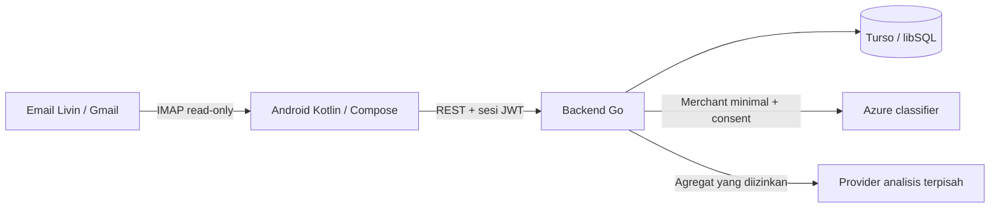

# PAM — Personal Finance Android App

PAM mengubah notifikasi email **Livin by Mandiri** dan transaksi manual menjadi
rekap arus kas bulanan. Pengguna dapat meninjau kategori, meminta bantuan kategorisasi
Azure, dan mengakses analisis serta perencanaan anggaran sesuai consent masing-masing.

**Status:** dalam pengembangan · **Sprint aktif:** S2 / PARTIAL
**Pembaruan dokumentasi:** 23 November 2026 · **Branch kerja:** `feat/c2-android`
**SRS resmi:** v0.5 · **Release/merge/deploy:** belum dinyatakan selesai

> README ini adalah pintu masuk proyek. Riwayat pekerjaan, hasil tes, dan gate yang belum
> lulus dibedakan; commit atau jumlah tes tidak otomatis membuktikan fitur selesai.
> Snapshot terbaru: `ce56d9c` dan [review recovery PM](docs/reviews/PM_REVIEW_CE56D9C_SYNC_RECOVERY.md).
> Regresi scheduler terkait PASS; satu P1 recovery upload masih OPEN. Hasil TERLAPOR SE
> dan WIP yang belum diverifikasi tidak dihitung sebagai acceptance penuh.

## Daftar isi

1. [Ringkasan dan batas produk](#1-ringkasan-dan-batas-produk)
2. [Status sprint dan fitur](#2-status-sprint-dan-fitur)
3. [Progres harian](#3-progres-harian)
4. [Arsitektur dan struktur repository](#4-arsitektur-dan-struktur-repository)
5. [Menjalankan proyek lokal](#5-menjalankan-proyek-lokal)
6. [Pengujian dan bukti](#6-pengujian-dan-bukti)
7. [Konfigurasi, data, dan biaya](#7-konfigurasi-data-dan-biaya)
8. [Dokumentasi dan cara berkontribusi](#8-dokumentasi-dan-cara-berkontribusi)

## 1. Ringkasan dan batas produk

| Kebutuhan | Perilaku yang dituju |
|---|---|
| Pencatatan | Impor notifikasi Livin yang didukung parser, serta transaksi manual |
| Rekap | Perhitungan IDR deterministik, kategori, refund dan transfer internal |
| Kategori | Koreksi pengguna dipertahankan; saran AI mempunyai provenance dan status review |
| Pembaruan | Auto-sync Gmail dan antrean kategori terpisah, dengan status yang dapat diperiksa |
| Analisis/anggaran | Analisis berbasis agregat dan rencana anggaran; integrasi UI masih mengikuti gate delivery |

PAM bukan aplikasi bank: tidak menampilkan saldo rekening terverifikasi, memindahkan uang,
atau menjamin semua transaksi bank tercakup oleh email. `COMPLETE` merujuk pada pemrosesan
scope impor, bukan kelengkapan mutasi rekening. Empty, partial, failed, stale dan angka nol
harus tampil sebagai keadaan berbeda.

## 2. Status sprint dan fitur

### Posisi delivery

| Sprint | Cakupan | Status terakhir |
|---|---|---|
| S1 / fondasi | Android awal, auth dan baseline backend | Baseline tersedia; tidak sama dengan kelulusan proyek |
| **S2** | Integrasi Android–Go, impor, classifier, auto-sync, status UI | **PARTIAL — aktif** |
| S3 | CRUDS transaksi/kategori/anggaran dan dynamic fields | Belum lulus gate; sebagian backend tersedia |
| S4 | Lampiran, admin, visual dan cutover varian penilaian | Belum lulus gate |
| S5 | Verifikasi operasional, benchmark, perangkat dan owner UAT | Gate akhir masih terbuka |

### Implementasi versus acceptance

| Area | Yang sudah tersedia | Yang masih perlu dibuktikan/diselesaikan |
|---|---|---|
| Auth dan data server | Go, JWT/refresh, transaksi/list/detail/summary, consent dan koreksi kategori | Acceptance gabungan, seluruh CRUDS dan lifecycle sesuai mandat |
| Gmail/Livin | IMAP read-only, MIME/parser strict, incremental sync dan cursor | P1 retry otomatis lintas run: local commit belum terunggah dapat terlewat; backlog parser tetap terbuka |
| Azure classifier | Adapter, ledger/budget, cache, lease/recovery, caseId mapping dan USER override | Benchmark akurasi berlabel manusia; gate integrasi auto-queue |
| Auto-sync / batch | WorkManager 30 menit, antrean target 2 jam, endpoint enqueue/drain | Due window/server worker diuji ulang PASS; penutupan lane tertahan P1 recovery upload |
| Status UI | Pil top bar dan sheet; screenshot/layout dan cold-start E2E terlapor | Email baru sampai server/UI tanpa tap; partial/storage error dan refresh lambat |
| Kelengkapan penilaian | Kontrak 25 aksi dan empat entitas tersedia | S3/S4, lampiran/admin, dynamic fields dan audit Room/SQLCipher |

Temuan auto-sync tidak membuka kembali empat defect classifier lama yang sudah ditutup
pada `746b598`. Rincian implementasi/evidence: [living checkpoint](docs/DELIVERY_S2_S4_CHECKPOINT.md).
Dokumen itu memuat snapshot historis; baca bagian bertanggal terbaru dan keputusan review,
bukan hanya tabel atau hasil tes lama.

## 3. Progres harian

Tanggal memakai **Asia/Jakarta (WIB)**. Tabel berikut direkonstruksi dari Git/checkpoint;
bukan klaim setiap gate telah lulus pada tanggal tersebut.

| Tanggal | Fokus dan hasil utama | Verifikasi / batas bukti | Sisa utama |
|---|---|---|---|
| 19 Nov 2026 | Fondasi Compose/domain, backend awal dan kontrak klien | Riwayat source/test awal tersedia; bukan run ulang saat ini | Integrasi live dan arsitektur berikutnya |
| 20 Nov 2026 | Jalur IMAP/App Password, MIME, perbaikan analisis dan kajian pedoman | Perbaikan/parser fixture tercatat di Git | Integrasi nyata dan migrasi kepatuhan |
| 21 Nov 2026 | Onboarding, kontrak v0.4, migrasi Go dan baseline C1 | Backend lokal/interop dan emulator subset terdokumentasi | C2 Android dan kelengkapan CRUDS |
| 22 Nov 2026 | Parser strict, impor Go, consent, SRS v0.5, setup/runtime Azure | Unit/integration dan smoke berkembang per checkpoint; bukan benchmark | Runtime recovery dan Android acceptance saat itu |
| **23 Nov 2026** | Lane paralel S2/S3/S4: P1 recovery upload, paging/search + edit/hapus transaksi, anggaran server, kategori remote, lampiran, admin, atribut dinamis; CLI ops; P1 diperkuat (identitas run sebelum commit, snapshot dipulihkan, tanpa ack saat backend nonaktif) | Android 456 tests/0 failure + lint 0 error, Go semua paket ok; UAT emulator lampiran & admin PASS, atribut transaksi round-trip terbaca dari server; regresi recovery baru ikut hijau | **P1 fixed**; **S2.4/S2.5 PARTIAL; S3 belum gate penuh; S4.1 PARTIAL; S4.2 PASS runtime; S4.4 assessment variant NOT RUN**; gate eksternal (mailbox nyata, benchmark, hosting) tetap |

**[Buka log harian lengkap, commit, bukti, dan template pembaruan →](docs/PROGRESS_DAILY.md)**

Tidak ada persentase selesai tanpa denominator acceptance. Pekerjaan WIP tidak disamakan
dengan commit ter-push; smoke provider, unit test dan Android E2E dicatat terpisah.

## 4. Arsitektur dan struktur repository



Email mentah dan credential Gmail diproses di perangkat. Transaksi server-mode disimpan
melalui Go; merchant bisnis minimal hanya dikirim ke classifier dengan purpose yang sesuai.
Payload analisis agregat tidak diperlebar menjadi raw transaksi/email.

```text
pam-app/
├── app/                 Android, Compose UI, domain, data dan tests
├── backend-go/          Backend aktif: API, store, migrasi dan classifier
├── backend/             Node lama: referensi/interop; belum dipensiunkan
├── scripts/             Wrapper build, QA, dokumen dan utilitas
├── fixtures/            Fixture sintetis/interop
├── docs/
│   ├── PROGRESS_DAILY.md Log harian dan aturan pencatatan
│   ├── specifications/  SRS resmi
│   ├── plans/           Rencana delivery
│   ├── changes/         Change records dan draf kebutuhan
│   ├── evidence/        Bukti tersanitasi yang dilacak
│   ├── maintenance/     Aturan cleanup/retirement
│   └── archive/         Dokumen historis, bukan runbook aktif
└── AGENTS.md            Instruksi kerja dan commit/push
```

**Backend yang dijalankan untuk PAM adalah Go.** Node tidak perlu berjalan bersamaan dan
bukan jaminan rollback kompatibel dengan schema terbaru. Room/SQLCipher masih bagian
transisi yang perlu dikeluarkan dari varian penilaian sesuai gate S4.

## 5. Menjalankan proyek lokal

### Prasyarat

- Android SDK; minimum perangkat API 26, compile/target SDK 36.
- JDK 21 dan toolchain Go sesuai `backend-go/go.mod` serta wrapper proyek.
- Wrapper existing menggunakan `.toolchain/`, `.gradle-home/` dan SDK lokal;
  lokasi alternatif didukung melalui konfigurasi wrapper.

Semua perintah berikut dimulai dari root repository `pam-app`.

### A. Backend development terisolasi

```bash
cd backend-go
APP_ENV=development PORT=8080 \
  DATABASE_URL=file:./data/pam-readme-dev.db \
  REGISTRATION_INVITE_CODE=dev-local-only \
  LLM_PROVIDER=fake CATEGORY_LLM_ENABLED=false \
  ../scripts/go.sh run ./cmd/api
```

Perintah ini memakai database development lokal dan classifier nonaktif. Tidak menggunakan
database UAT pemilik atau membuat panggilan Azure. Kode invite di atas hanya contoh lokal,
bukan konfigurasi production. Konfigurasi rinci: [backend Go](backend-go/README.md) dan
[kontrak API](docs/06_BACKEND_CONTRACT.md); beberapa status dalam README backend bersifat historis.

### B. Build Android menuju backend lokal

Di terminal lain, dari root repository:

```bash
./scripts/build.sh :app:assembleDebug -PPAM_BACKEND_BASE_URL=http://10.0.2.2:8080
```

APK: `app/build/outputs/apk/debug/app-debug.apk`.
`10.0.2.2` dipakai emulator untuk mengakses host. Perangkat fisik memerlukan endpoint yang
reachable atau `adb reverse`; jangan menganggap localhost HP sama dengan localhost laptop.
Debug UAT existing memakai port 18090 dan dapat memakai `127.0.0.1` dengan `adb reverse`;
itu konfigurasi terpisah, bukan service publik 24/7.

Setelah install: buat/login akun, pilih consent, lalu hubungkan Gmail jika diperlukan.
Gunakan Gmail **App Password** pada layar koneksi, bukan password utama Gmail. Fixture/demo
harus berlabel; keberhasilan demo tidak membuktikan data server atau mailbox nyata.

### C. UAT Azure

Ikuti [setup Azure](docs/AZURE_CLASSIFIER_SETUP.md) dan instruksi pemilik/mandat aktif.
Launcher `scripts/run_real_uat_with_classifier.py` **mengaktifkan classifier**; jangan
memakainya sebagai startup development biasa. Pengujian fault injection memakai fixture
terisolasi. README ini tidak mengotorisasi perubahan cloud atau aktivasi pada data nyata.

## 6. Pengujian dan bukti

### Android

```bash
./scripts/build.sh :app:testDebugUnitTest
./scripts/build.sh :app:assembleDebug :app:lintDebug
```

### Go

```bash
cd backend-go
../scripts/go.sh test -race -count=1 ./...
../scripts/go.sh vet ./...
../scripts/go.sh build ./...
```

| Jenis bukti | Yang dapat dibuktikan | Bukan bukti untuk |
|---|---|---|
| Unit/regression | Cabang perilaku dan kasus gagal yang diasert | Seluruh UX/runtime nyata |
| Integration | API/persistence/race dalam lingkungan uji | Semua kondisi cloud/perangkat |
| Smoke Azure | Request/response provider tertentu | Akurasi tinggi pada transaksi umum |
| Emulator E2E | Satu alur UI sampai persistence yang diamati | Alur lain atau seluruh sprint |
| Screenshot/layout | State visual yang dirender | Provider call, jadwal background atau TalkBack manual penuh |
| Owner UAT/benchmark | Penerimaan/evaluasi sesuai skenario dan dataset | Klaim bebas defect mutlak |

Evidence yang dilacak: `docs/evidence/` dan [checkpoint](docs/DELIVERY_S2_S4_CHECKPOINT.md).
Screenshot/status E2E berada pada direktori build lokal sesuai checkpoint, bukan selalu
tersedia di clone baru. `scripts/qa/e2e_update_status.py` menguji cold-start/status panel;
itu **belum** bukti lengkap email baru → delta → server → UI.

## 7. Konfigurasi, data, dan biaya

- Consent `GMAIL_READ`, `AI_CATEGORIZATION`, dan `AI_PROCESSING` independen.
- Gmail App Password tetap di vault privat Android. Logout tidak otomatis menghapus tautan
  akun yang sama; disconnect/deletion dan owner isolation mengikuti lifecycle yang berlaku.
- Token Turso, key Azure dan secret backend tidak berada di APK/Git/log. Jangan menyalin
  isi `.env` atau konfigurasi privat ke laporan.
- Total arus kas exact minor integer; bulan transaksi memakai Asia/Jakarta.
- USER override dipertahankan. Saran AI bukan keputusan pengguna atau probabilitas akurasi.
- Transaksi tetap tersimpan ketika kategorisasi gagal/budget habis; backend unavailable
  tidak boleh ditampilkan sebagai data kosong atau saldo nol.

| Kontrol classifier | Batas pilot yang dimandatkan |
|---|---|
| Budget runtime global | USD0,10/hari dan USD2/bulan |
| Outbound attempts | 20/owner/hari; 100/backend installation/hari, termasuk retry |
| Ukuran request | Maksimal 5 merchant unik; cap input/completion sesuai kontrak |
| Konkurensi dan retry | Maksimal 2 bersamaan; timeout 20 detik; maksimal 1 retry transient |
| Cloud budget Foundry | USD10/bulan sebagai lapisan luar; dukungan blocking GPT-OSS belum dibuktikan |

Azure menggunakan token berbayar dan kredit Student terbatas; jangan menyebut seluruh stack
selalu gratis. Biaya estimasi token berbeda dari tagihan Azure. Budget dan request cap juga
berbeda dari jaminan jadwal batch; integrasi worker/jadwal masih dalam review.
[Catatan cloud budget](docs/AZURE_MONTHLY_BUDGET_HANDOFF.md) ·
[Verifikasi harga](docs/evidence/azure_price_verification_2026-11-22.md).

## 8. Dokumentasi dan cara berkontribusi

| Dokumen | Kegunaan |
|---|---|
| [Progres harian](docs/PROGRESS_DAILY.md) | Hasil per tanggal, bukti, gate terbuka dan template update |
| [Living checkpoint](docs/DELIVERY_S2_S4_CHECKPOINT.md) | Handoff implementasi dan snapshot pengujian |
| [Mandat S2–S4](docs/agent-prompts/MANDAT_S2_S4.md) | Scope dan matriks 25 aksi CRUDS |
| [Mandat sub-agent paralel](docs/agent-prompts/PROMPT_SE_PARALLEL_DELIVERY.md) | Tiga worker, worktree terpisah, ownership dan gate integrasi |
| [Rencana auto-sync/status](docs/plans/AUTO_SYNC_CATEGORY_STATUS_PLAN.md) | AS/BC/UX/OBS acceptance dan dependency |
| [Draf CR-005](docs/changes/CR_005_DRAFT_AUTO_SYNC_BATCH_STATUS.md) | Perubahan untuk revisi SRS nanti; bukan SRS resmi baru |
| [SRS v0.5 DOCX](docs/specifications/PAM_SRS_v0.5_Azure_LLM.docx) / [PDF](docs/specifications/PAM_SRS_v0.5_Azure_LLM.pdf) | Baseline formal; belum direvisi pada perapian ini |
| [Traceability](docs/01_SCOPE_TRACEABILITY.md) / [Arsitektur](docs/03_ARCHITECTURE.md) / [API](docs/06_BACKEND_CONTRACT.md) | Requirement, data flow dan wire contract; perhatikan tanggal snapshot |
| [Cleanup/retirement](docs/maintenance/RETIREMENT_POLICY.md) | Menghapus obsolete dan mengarsipkan histori dengan aman |
| [Arsip README sebelumnya](docs/archive/README_BEFORE_RESTRUCTURE_2026-11-23.md) | Riwayat dokumentasi, bukan petunjuk runtime terbaru |

Baca [AGENTS.md](AGENTS.md) sebelum bekerja. Setiap perubahan koheren di-commit lalu
langsung di-push ke branch kerja yang sama. Merge/deploy memerlukan instruksi terpisah.
Perbarui baris tanggal hari ini pada log harian dengan commit, bukti dan gate tersisa;
jangan menulis PASS hanya karena source ditambahkan atau build berhasil.

**Gate terbuka:** correctness auto-sync, seluruh S2–S4 yang belum diterima, benchmark
berlabel manusia, coverage parser yang belum terbukti, serta perangkat/background,
backup/restore, availability dan owner UAT sesuai gate S5.
