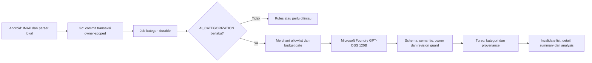
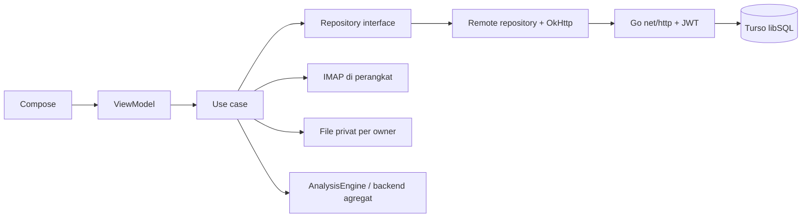

# PAM — Architecture

## Perluasan v0.5 — Azure LLM kategori (22 November 2026)

[CR-004](changes/CR_004_AZURE_LLM_CATEGORIZATION.md) dan SRS lengkap v0.5 memperluas target
dengan classifier typed/purpose-scoped. Cloud deployment dan synthetic smoke telah lulus;
diagram ini adalah arsitektur aplikasi yang masih harus diimplementasikan dan diuji.



Jalur analisis agregat tetap memakai AI_PROCESSING dan FR-35; merchant tidak ditambahkan ke
payload tersebut. Key Azure hanya backend. Resource Japan West/GlobalStandard tidak berarti
semua inference berada di Jepang/Indonesia. USER override dan angka sumber tidak diubah model.
Rincian private setup dan batas evidence: [AZURE_CLASSIFIER_SETUP.md](AZURE_CLASSIFIER_SETUP.md).

> **Status dokumen (21 Nov 2026).** Bagian 0 adalah target **v0.4** yang sedang direview. Bagian
> 1–9 di bawah mendokumentasikan implementasi **v0.3** dan dipertahankan sebagai riwayat; jika
> bertentangan (Room, OAuth, GoogleGmailSource), bagian 0 yang berlaku untuk target. Kontrak HTTP
> ada di [`06_BACKEND_CONTRACT.md`](06_BACKEND_CONTRACT.md); skema ada di
> [`10_MIGRASI_PEDOMAN.md`](10_MIGRASI_PEDOMAN.md).

## 0. Target v0.4 — arsitektur dan perubahan UI

### 0.1 Batas lapisan

```
ui (Compose) → domain (use case/repository interface) ← data (remote REST, local files, IMAP, AI)
```

- `domain` tetap murni Kotlin: tidak ada OkHttp, Room, Android, atau serialisasi transport.
- `data/remote/` berisi implementasi REST + DTO; `data/local/` hanya untuk Keystore/DataStore dan
  file privat, **bukan** database transaksi. Room/SQLCipher dihapus dari varian penilaian pada D.
- API target adalah layanan **Go** (repo terpisah `0037-Backend-Financial`, Go 1.27.4, `net/http`, `database/sql`, driver
  libSQL remote/lokal). Node `backend/` hanya referensi perilaku dan rollback selama migrasi; lihat
  [`13_GO_BACKEND_MIGRATION.md`](13_GO_BACKEND_MIGRATION.md).
- R1 memakai token Manrope/light warm di `ui/theme`; empat layar B01–B04 menjadi kandidat
  visual lokal. Handoff ada di [`15_DESIGN_R1_HANDOFF.md`](15_DESIGN_R1_HANDOFF.md).
- C2A memakai `ServerFinanceRepository` sebagai port domain: transaksi manual,
  daftar/detail dan computed summary berasal dari Go saat URL dikonfigurasi;
  Room hanya jalur legacy/offline. Analisis memakai payload aggregate **canonical server**, bukan angka kiriman klien. Idempotensi
  create/import disimpan atomik; finalisasi analisis memeriksa ulang consent, deletion, sesi dan
  revisi; usage provider dicatat untuk ceiling biaya harian.
- `data/gmail/` tetap di perangkat (IMAP read-only); `data/ai/` tetap di balik `AnalysisEngine`.
- Repository interface di `domain/repository/` dipertahankan; implementasi berganti dari Room ke
  REST. Use case tetap memiliki aturan (validasi, owner, revisi), bukan ViewModel.

### 0.2 Alur data



### 0.3 Perubahan UI

| Layar | Perubahan v0.4 |
|---|---|
| Welcome/Account | Tanpa Google Sign-In; register/login backend, role dari respons |
| Consent | Tetap dua izin terpisah; teks menyebut transaksi disimpan di server PAM |
| Gmail connect | App Password + state; demo mailbox hanya mode offline berlabel |
| Overview | Memuat ringkasan server; state loading/empty/partial/error/unavailable; `EMAIL-DERIVED` |
| Transactions | List/filter/search REST, cursor; badge manual/import; soft delete |
| Transaction detail | Editor kategori/catatan/atribut; daftar lampiran + status file lokal |
| Manual entry | Simpan ke REST dengan idempotency key; retry aman |
| Import job | Job/batch server; matched/imported/duplicate/skipped/unresolved + reason |
| Budget plan | Rencana + limits + editor atribut; gap dihitung server |
| **Admin users** (baru) | List/cari, invite/create, ubah role/status, soft delete, audit |
| **Admin user detail** (baru) | Detail akun, last-admin guard, revoke sesi |
| Settings | Sesi/refresh, consent, mailbox, retensi, deletion; tanpa token di UI |

### 0.4 Editor field dinamis

Empat entitas memakai editor key–value terbatas (maks. 10 pasangan, key ≤40 char, value ≤200 char,
total ≤2 KB JSON): transaksi, kategori, rencana anggaran, metadata lampiran. Nilai disimpan sebagai
JSON tersegel di server; UI menampilkan, mengedit, dan membaca ulang setelah restart. Kategori
bawaan tidak dapat dihapus; kategori pengguna yang masih dipakai harus di-reassign atau ditolak.

### 0.5 Lampiran lokal

1. Android document picker (`OpenDocument`) → validasi MIME/ukuran.
2. Salin ke `filesDir/attachments/<ownerId>/<localFileId>` (privat, tanpa backup cloud).
3. `POST /v1/attachments` metadata; bila gagal → hapus salinan atau retry queue.
4. Buka ulang dari path privat; perangkat lain menampilkan metadata `fileAvailable=false`.
5. Hapus: server tombstone dulu, lalu hapus file; bila hapus file gagal, retry queue.
6. Hapus transaksi: metadata ikut tombstone; file dibersihkan klien.

### 0.6 State auth dan sinkronisasi

- `AuthState`: `Restoring → Authenticated(access,expiry) → Refreshing → Authenticated |
  SessionExpired`. Satu refresh single-flight; request paralel menunggu hasil yang sama.
- Request API: 401 → satu refresh → ulang request sekali; bila masih 401 → `SessionExpired`.
- 503 `database_unavailable`: tampilkan unavailable + tombol coba lagi; form dipertahankan.
- Perubahan data menaikkan `month_revisions`; layar ringkasan/analisis mendeteksi `inputRevision`.

### 0.7 Pengujian arsitektur

- Unit: use case + DTO mapping + calculator; tanpa jaringan.
- Remote: MockWebServer untuk 401/refresh, 409 revision, 503, cursor.
- UI: Compose test untuk loading/empty/error, editor dinamis, admin guard, aksesibilitas.
- E2E: emulator + backend lokal + database `file:` terisolasi; cloud test terpisah **NOT RUN**
  sampai kredensial uji tersedia.


Single Gradle module (`:app`), Hilt DI, MVVM + unidirectional state, Repository/Port boundary.
Package root `com.pam.recap`.

```
com.pam.recap
├── core/
│   ├── money/        Money (minor units), IdrFormatter, PercentChange
│   ├── time/         JakartaMonth, ClockProvider, MonthRange
│   ├── result/       Outcome<T>, AppError, SafeLogger
│   ├── security/     KeystoreSecretStore, DatabasePassphraseProvider, FingerprintFactory
│   └── di/           qualifiers & common modules
├── domain/
│   ├── model/        Pure Kotlin models — no Android, no Room annotations
│   ├── repository/   Interfaces (ports owned by the domain)
│   └── usecase/      One class per rule; all suspend/Flow, all pure where possible
├── data/
│   ├── local/        Room entities, DAOs, converters, PamDatabase, migrations
│   ├── prefs/        DataStore (session, consent cache, settings)
│   ├── gmail/        GmailSource port impls: GoogleGmailSource, FixtureGmailSource
│   ├── ai/           AnalysisEngine port impls: OnDeviceAnalysisEngine, RemoteAnalysisEngine
│   ├── repository/   Repository impls (map entity ⇄ domain)
│   └── seed/         Demo fixtures (sanitized Livin QRIS emails) + demo dataset
├── ui/
│   ├── theme/        tokens (done)
│   ├── components/   design-system primitives
│   ├── navigation/   PamDestinations, PamNavHost, bottom bar
│   └── feature/<x>/  <X>Screen.kt, <X>ViewModel.kt, <X>UiState.kt, components
└── MainActivity.kt, PamApplication.kt
```

**Dependency rule:** `ui → domain ← data`. `domain` has no Android/Room/OkHttp imports.
`core/money` and `core/time` are pure Kotlin (JVM-testable).

---

## 1. Money

```kotlin
@JvmInline value class Money(val minor: Long)          // 1/100 IDR, exact base-10
object IdrFormatter { fun format(m: Money): String }   // "Rp1.200.000" , "Rp5.100.000,00"
```
- Arithmetic only through `Money.plus/minus/times`. No `Double` anywhere in money paths.
- Display: Indonesian grouping (`.`), decimal `,`, no decimals when both cents are zero,
  `Rp` prefix with no space. Negative never rendered with `-`; use explicit sign/colour/word.
- `PercentChange` is a sealed type: `Value(Double)` | `NotApplicable` (zero/missing base).

## 2. Time

```kotlin
data class JakartaMonth(val year: Int, val month: Int) {
  fun range(): MonthRange          // [start, nextStart) in Asia/Jakarta (BR-01)
  fun id(): String                 // "2026-01"
}
```
`MonthRange` = `startInclusiveInstant`, `endExclusiveInstant`, plus display label.
Import search window = range widened by `INGESTION_BUFFER_DAYS = 3` (BR-01/OI-05).

## 3. Domain models

```kotlin
enum class Direction { CREDIT, DEBIT }
enum class TransactionSource { EMAIL, MANUAL }
enum class CategoryOrigin { IMPORTED, RULE, USER }
enum class ClassifiedKind { INCOME, EXPENSE, TRANSFER, UNCATEGORIZED }

enum class Category(val code: String, val kind: ClassifiedKind, ...) {
  INCOME, HOUSING, FOOD, TRANSPORT, UTILITIES, SHOPPING, HEALTH, EDUCATION, OTHER_EXPENSE,
  TRANSFER, UNCATEGORIZED
}

data class Transaction(
  val id: String, val ownerId: String,
  val direction: Direction, val source: TransactionSource,
  val amount: Money, val currency: String,          // "IDR"
  val eventAt: Instant,                             // parsed transaction time (BR-01)
  val receivedAt: Instant?,                         // Gmail internalDate (NFR-04)
  val description: String,                          // normalized, minimal
  val merchantLabel: String?,                       // local only, never sent to LLM
  val acquirer: String?,                            // local only
  val status: ParseStatus,                          // POSTED / FAILED / UNRESOLVED
  val fingerprint: String,                          // opaque per-user HMAC (FR-18)
  val parserVersion: String,
  val parserConfidence: Float,
  val category: Category, val categoryOrigin: CategoryOrigin,
  val categoryConfidence: Float?, val categoryUpdatedAt: Instant?,
  val isInternalTransfer: Boolean,
  val linkedRefundOf: String?,                      // BR-03
  val note: String?,                                // private, local only
  val importJobId: String?, val revision: Int,
  val createdAt: Instant, val updatedAt: Instant,
)
```

`MonthlySummary` (FR-30): `month`, `mailboxLabel`, `grossInflow`, `grossOutflow`, `netCashFlow`,
`classifiedIncome`, `classifiedExpense`, `categoryTotals: List<CategoryTotal>`,
`uncategorizedCount`, `manualEntryCount`, `coverage: CoverageStatus`, `inputRevision`,
`summaryVersion`, `generatedAt`.

`CoverageStatus` = `Complete | Partial | Empty | Failed` (NFR-11: all four distinct).
`PercentChange` for prior-month deltas (FR-31).

`Analysis`: `id, summaryId, inputRevision, consentId, providerId, modelId, promptVersion,
observations: List<Observation>, suggestions: List<Suggestion>, limitations: List<String>,
status: AnalysisStatus, validation: ValidationOutcome, usage, createdAt`.
`Observation` carries `metricKeys: List<String>` (FR-36 evidence references).
`AnalysisStatus` = `Available | Provisional | Outdated | Historical | Unavailable | Rejected`.

`BudgetPlan`: `month`, `expectedIncome`, `plannedSavings`, `limits: Map<Category, Money>`,
`gap`, `revision`, `valueOrigins: Map<Category, ValueOrigin>`.

---

## 4. Room schema (version 1, `exportSchema = true`)

| Entity | Key columns / indices |
|---|---|
| `TransactionEntity` | `id` PK; unique index `(ownerId, fingerprint)`; index `(ownerId, eventAt)`; index `(ownerId, category)` |
| `ImportJobEntity` | `id` PK; index `(ownerId, monthId)`; pages, counts, `state` |
| `SkippedCandidateEntity` | `id` PK; `jobId` index; `reasonCode` (enum, redacted — FR-15) — stores **no** subject/body |
| `MonthlySummaryEntity` | `id` PK; unique `(ownerId, monthId, inputRevision)` |
| `SummaryCategoryTotalEntity` | `(summaryId, categoryCode)` PK |
| `AnalysisEntity` | `id` PK; index `(ownerId, monthId)`; serialized sections as JSON `String` via `kotlinx.serialization` |
| `BudgetPlanEntity` + `BudgetLimitEntity` | `(ownerId, monthId)` unique for active plan |
| `ConsentEntity` | `id` PK; `(ownerId, purpose)` index; purpose/noticeVersion/decision/decidedAt |
| `GmailConnectionEntity` | `ownerId` PK; `state`, `mailboxLabel`, `scope`, `lastImportAt`, `lastAiAt` |
| `DeletionRequestEntity` | `id` PK; `state`, `requestedAt`, `completedAt` |
| `AppMetadataEntity` | already present — keep |

`Converters`: `Instant ⇄ Long`, `Money ⇄ Long`, enums ⇄ String.
DB stays SQLCipher-encrypted (already wired). No `fallbackToDestructiveMigration` in release;
add a migration when the schema changes.

---

## 5. Ports

```kotlin
interface GmailSource {                                  // FR-06..FR-21, NFR-26
  suspend fun authorize(): Outcome<Unit>
  fun connectionState(): Flow<GmailConnectionState>
  suspend fun search(query: LivinQuery, pageToken: String?): Outcome<GmailPage>
  suspend fun fetchMessage(id: String): Outcome<RawMessage>   // parsed in memory only
  suspend fun disconnect(): Outcome<Unit>
}
enum class GmailConnectionState { NOT_CONNECTED, AUTHORIZATION_PENDING, CONNECTED,
                                  REAUTHORIZATION_REQUIRED, UNAVAILABLE, DISCONNECTED }

interface AnalysisEngine {                               // FR-34..FR-41, NFR-26
  val providerId: String; val modelId: String
  suspend fun analyze(payload: AiAggregatePayload): Outcome<RawAnalysis>
}
```

Implementations:
- `GoogleGmailSource` — real: Credential Manager / `AuthorizationClient` for `gmail.readonly`,
  OkHttp against `https://gmail.googleapis.com/gmail/v1/users/me/...`, MIME text-part
  extraction, attachments ignored. Enabled only when `BuildConfig.PAM_GOOGLE_WEB_CLIENT_ID`
  is non-blank; otherwise the DI graph binds `FixtureGmailSource`.
- `FixtureGmailSource` — deterministic, sanitized QRIS fixtures + pagination + reproducibility
  for tests and demos. Same port, same states, same failure modes.
- `OnDeviceAnalysisEngine` — deterministic, evidence-bound analysis over metrics; no network.
- `RemoteAnalysisEngine` — POSTs the allow-listed aggregate payload to a configured backend.

## 6. Key use cases

`SignInUseCase`, `SignOutUseCase`, `RecordConsentUseCase`, `WithdrawAiConsentUseCase`,
`ConnectGmailUseCase`, `DisconnectGmailUseCase`,
`ImportMonthUseCase` (pagination → parse → dedupe → upsert → job record),
`RetryImportUseCase`, `ParseLivinNotificationUseCase`,
`AddManualEntryUseCase`, `UpdateTransactionCategoryUseCase`, `MarkInternalTransferUseCase`,
`LinkRefundUseCase`, `ObserveTransactionsUseCase`, `SearchTransactionsUseCase`,
`ComputeMonthlySummaryUseCase`, `ObserveCoverageUseCase`,
`RequestAnalysisUseCase`, `ValidateAnalysisUseCase`,
`SuggestBudgetPlanUseCase`, `SaveBudgetPlanUseCase`, `ComparePlanToActualUseCase`,
`RequestDeletionUseCase`.

`CashFlowCalculator` is a **pure object** implementing BR-01…BR-06, unit-tested against the
SRS B5 example.

## 7. State machines

**Import** (FR-19, B4): `Created → Running → (Complete | Partial | Failed | PermissionRequired)`.
`Partial → Running` on retry. `Complete` = all configured pages processed (query coverage only).

**Analysis** (FR-34…FR-41): `Requested → ConsentChecked → SummaryFrozen → ProviderPending →
Validated → Available`. One bounded regeneration on invalid output, then `Unavailable`.
Consent revoked mid-flight ⇒ discard. Changed input revision ⇒ existing result `Outdated`.
Partial coverage ⇒ `Provisional`.

## 8. Screen acceptance criteria

Each screen must ship loading / empty / partial / error / offline states, use only string
resources, and expose its content to TalkBack.

**Welcome** — wordmark + tagline, `hero`+`aurora` background, privacy notice link, primary
`PillButton` "Masuk dengan Google", secondary "Lihat kebijakan privasi". Sign-in success →
`consent`. Rejection → neutral inline error (FR-01). Never asks for a Google password (FR-08).

**Consent** — two independent `ConsentSwitchRow`s: Gmail read-only, AI processing. Body copy
states exactly what leaves the device. "Lanjut" enabled when Gmail decision made; AI may be
declined and summaries stay usable (FR-03, FR-04).

**Gmail connect** — mailbox state card with one of the six states, `connect`/`disconnect`
controls, last successful import, guidance per state (FR-07, FR-10, FR-49). Displays the
`gmail.readonly` scope label, never a token.

**Overview** — month selector, `EMAIL-DERIVED` chip, hero glass card with net cash flow,
2-up `StatTile` (gross in / gross out), `ProgressRing` for expense composition, classified
income/expense, category list with drill-down, coverage banner (`Partial`/`Empty`), recent 3
transactions, and an import CTA showing freshness (FR-28…FR-33).

**Transactions** — `MonthStrip` + filter chips + search, grouped list by date, each row shows
direction glyph, description, time, amount, category, source badge and low-confidence marker.
Empty and "no matching emails" are different states (FR-20, FR-27).

**Transaction detail** — amount hero, provenance block (source, parser version, confidence,
fingerprint preview, event vs received time), category selector, transfer toggle, refund link,
private note, audit trail. Amount/date/direction are read-only (FR-17, FR-25).

**Manual entry** — direction toggle, amount, date, category, description; saves with
`source = MANUAL` and a `Manual` badge everywhere (FR-26).

**Analysis** — consent + provider disclosure preamble, generate/regenerate, observations with
metric references, suggestions, limitations, status chips `Provisional`/`Outdated`/`Historical`,
and an explicit "Analysis unavailable" fallback while summaries stay readable (FR-34…FR-41).

**Budget plan** — expected income, planned savings, per-category limit sliders/fields seeded
from historical averages (labelled), live `PlanningGap` with shortfall banner, save is explicit
and performs no external action (FR-42…FR-45).

**Settings / privacy** — connection state, consent history entry point, last import/AI times,
sign out, disconnect Gmail, delete data with retention explanation (FR-46…FR-49).

## 9. Testing

Required unit tests (JVM, `app/src/test`):
1. `CashFlowCalculator` — SRS B5 worked example exactly; transfers in gross but not classified;
   refund nets its category; non-IDR excluded; zero previous month ⇒ `NotApplicable`.
2. `IdrFormatter` — grouping, decimals, no `-` sign, 200 % font-scale-safe strings.
3. `JakartaMonth` boundary — 23:59:59 on the last day is in-month, 00:00:00 next month is out.
4. `LivinQrisParser` — supported fixture; failed payment; missing amount ⇒ `Unresolved`
   (never zero); attachment-only excluded; unknown template excluded; injected instructions in
   body are ignored.
5. `FingerprintFactory` — deterministic, per-user, changes when fields change, collides flagged.
6. `AiPayloadBuilder` — forbidden-field scan: no body/subject/sender/id/token/PAN/merchant.
7. `AnalysisValidator` — invented totals rejected, missing evidence rejected, prompt-injection
   output rejected, one regeneration max.
8. `PlanningGap` — income 5,000,000 − savings 1,000,000 − limits 4,500,000 ⇒ shortfall 500,000.

Definition of done: `./scripts/build.sh :app:assembleDebug :app:testDebugUnitTest` is green and
`./scripts/build.sh :app:lintDebug` reports no error-severity findings.
