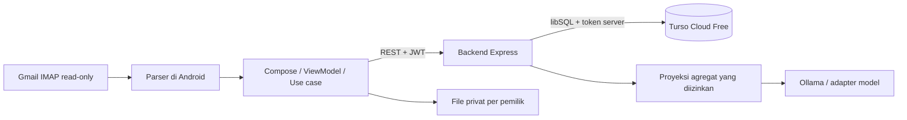

# Rancangan kepatuhan PAM dengan Turso Free

Diperbarui 21 November 2026. Menggantikan rancangan MySQL pada 20 November.

Pemilik telah mengarahkan penggunaan cloud database gratis dan menjelaskan bahwa MySQL adalah baseline minimum dalam pedoman. Pilihan lead adalah **Turso Cloud Free dengan engine libSQL**. Backend saat ini sudah menggunakan `@libsql/client`, migrasi berurutan, dan enkripsi payload. Rancangan ini memakai integrasi tersebut untuk seluruh data bisnis melalui REST. Larangan Room pada pedoman D.8 tetap berlaku.

Dokumen ini adalah rancangan target. Kode pada `fix/onboarding-import-stability` / `fe3a183` masih menjalankan v0.3. Lokasi transaksi di server, penghentian operasi offline penuh, dua peran, dan lima CRUDS berikut merupakan keputusan desain yang diajukan untuk v0.4. Persetujuan cloud gratis telah diterima. Sign-off keseluruhan CR-002 belum tercatat.

## 1. Pilihan layanan dan biaya

| Komponen | Rancangan |
|---|---|
| Database demo | Turso Cloud Free, engine libSQL yang kompatibel dengan driver existing |
| Backend | Node 24 + Express + TypeScript yang sudah ada, berjalan di laptop saat pengembangan dan presentasi |
| Android | Kotlin + Compose + Navigation Compose + MVVM/Hilt, mengakses REST backend |
| Model | Ollama lokal melalui adapter yang sudah tersedia, dengan analisis deterministik saat layanan model gagal sesuai kontrak |
| File | Foto/PDF dipilih pengguna dan disalin ke penyimpanan privat Android, metadata disimpan di database |
| Biaya target | Rp0 untuk langganan layanan pada penggunaan dalam kuota Free |

Halaman resmi Turso saat diperiksa menyediakan 100 database, penyimpanan total 5 GB, 500 juta baris dibaca/bulan, dan 10 juta baris ditulis/bulan pada Free. Kapasitas ini merupakan batas layanan, dengan kecukupan untuk dataset akademik sebagai estimasi desain. Periksa plan dan pemakaian akun sebelum demo. [Turso pricing](https://turso.tech/pricing)

Backend hidup selama laptop hidup. Emulator mengakses host melalui `10.0.2.2`, HP USB dapat memakai `adb reverse`, dan akses jarak jauh memakai URL HTTPS backend yang disiapkan saat diperlukan. Kebutuhan backend publik 24 jam memerlukan keputusan hosting tersendiri. Penggunaan cloud database dapat dibuktikan meskipun proses API berjalan di laptop.

## 2. Alur data target

Token Turso dan kunci penandatangan JWT berada pada backend. Android menyimpan refresh token terbungkus Keystore dan kredensial IMAP pada vault yang sudah ada. Penerbitan JWT/refresh adalah tanggung jawab aplikasi backend. Token database memiliki tujuan berbeda dari sesi pengguna.

Email mentah dibaca sementara di perangkat. Baris hasil parsing dan transaksi manual menjadi data server dalam target v0.4. Proyeksi untuk AI tetap hanya agregat yang telah disetujui. Merchant, catatan pribadi, metadata bebas, dan label kategori buatan pengguna dikecualikan dari payload model. Pemberitahuan privasi harus menyebut penyimpanan transaksi server-side sebelum aktivasi pada data nyata.

## 3. Skema logis dan relasi

Gunakan tabel yang sudah ada dan migrasi baru yang berurutan. Tabel berikut adalah target logis, dengan detail DDL ditulis worker setelah meninjau schema existing.

| Entitas | Field dan relasi inti | Tampilan/field dinamis |
|---|---|---|
| users | owner_id, email, password hash/salt, display_name, role, status | Profil dan administrasi |
| categories | id, owner_id, code, label, kind, color, attributes_json, deleted_at | Editor kategori dengan atribut tambahan |
| transactions | id, owner_id, category_id, direction, amount_minor, currency, event_at, fingerprint, source, revision, metadata_json, deleted_at | Daftar/detail/editor transaksi |
| budget_plans | id, owner_id, month_id, expected_income_minor, planned_savings_minor, revision, attributes_json, deleted_at | Daftar/detail/editor anggaran |
| budget_limits | owner_id, plan_id, category_id, amount_minor | Batas per kategori pada rencana |
| attachments | id, owner_id, transaction_id, device_ref, local_file_id, display_name, mime, size_bytes, attributes_json, deleted_at | Lampiran transaksi dan pencarian nama |
| refresh_tokens | id, owner_id, session_family_id, token_hash, expires_at, revoked_at, replaced_by | Internal auth |
| import_jobs | id, owner_id, month_id, progress, coverage, imported_count, revision | Kemajuan dan hasil impor |
| summaries, analyses, consents, deletion_requests | Perluasan tabel existing dengan referensi dan revisi yang sesuai | Ringkasan, analisis, izin, penghapusan |

Empat entitas utama untuk D.5 adalah kategori, transaksi, rencana anggaran, dan metadata lampiran. Setiap entitas memiliki form dinamis yang dapat ditulis, dibaca ulang, diedit, dan tampil di UI. Simpan objek JSON sebagai TEXT terverifikasi sesuai dialect libSQL. Batasi ukuran, jumlah, dan tipe atribut dalam kontrak.

Gunakan UUID/string stabil untuk ID. Owner berasal dari sesi terverifikasi. Relasi kategori, transaksi, rencana/batas, dan lampiran harus memeriksa kesamaan owner, termasuk lewat composite foreign key ketika sesuai. Pertahankan `UNIQUE(owner_id, fingerprint)`, indeks pencarian berbasis owner, dan mata uang dalam unit minor integer. Periksa integer aman saat serialisasi TypeScript serta tolak overflow.

Sediakan indeks `(owner_id, month_id)` atau `(owner_id, event_at)` sesuai kebutuhan, pagination, serta revisi deterministik setelah perubahan data. Foreign key dan rollback harus dibuktikan juga pada engine cloud yang digunakan.

Desain pencarian perlu mengakomodasi enkripsi. Pertahankan AES-GCM untuk payload agregat/analisis/rencana. Untuk merchant, catatan, dan atribut sensitif baru, gunakan helper enkripsi existing. Kolom untuk filter terstruktur seperti owner, tanggal, arah, dan kategori dapat diindeks. Pencarian teks sensitif dilakukan backend setelah dekripsi pada rentang bulan yang dibatasi, dengan pagination hasil yang benar. Kontrak harus menjelaskan rentang pencarian. Jangan menerapkan SQL LIKE pada ciphertext.

## 4. Lima fitur CRUDS dan file lokal

| Fitur | Create | Read | Update | Delete | Search |
|---|---|---|---|---|---|
| Transaksi | Manual/impor | Daftar/detail | Kategori, catatan, atribut | Hapus satuan | Deskripsi pada rentang terpilih |
| Kategori | Buat kategori | Daftar/detail | Label, warna, atribut | Hapus kategori pengguna | Nama |
| Anggaran | Buat rencana bulanan | Daftar/detail | Nominal, batas, atribut | Hapus rencana | Bulan/nama |
| Lampiran | Pilih dan salin file | Buka ulang | Nama/atribut | Hapus file dan metadata | Nama |
| Pengguna admin | Buat/invite dari UI admin | Daftar/detail | Nama, peran/status | Soft delete dengan revoke sesi | Email/nama |

Soft delete mengecualikan data dari daftar aktif dan total, menyimpan aturan retensi, dan bisa diperlihatkan lewat UI. Penghapusan kategori yang direferensikan memerlukan pilihan pemindahan kategori yang atomik atau penolakan yang jelas. Admin mengelola akun. Akses finance tetap owner-scoped. Lindungi admin aktif terakhir dan larang eskalasi peran dari endpoint profil biasa.

File dibaca lewat pemilih dokumen dan disalin ke direktori privat yang terikat owner. Server menyimpan referensi lokal abstrak dan metadata yang diperlukan. Pada perangkat lain, metadata dapat muncul dengan status file belum tersedia. Uji kegagalan simpan metadata setelah copy file, kegagalan hapus file, restart, sign-out berganti pemilik, dan penghapusan transaksi. Cleanup/retry harus menjaga konsistensi. [Android SAF](https://developer.android.com/guide/topics/providers/document-provider)

## 5. Auth, impor, dan sumber data

JWT access berumur maksimum 15 menit, dengan subject, issuer, audience, role, expiry, dan referensi sesi. Refresh token disimpan hashed di server dan diputar secara atomik. Backend memeriksa status akun/sesi serta akses peran agar logout, penghapusan akun, atau perubahan role berlaku sesuai kontrak. Klien memakai satu refresh terkoordinasi untuk request paralel dan retry paling banyak sekali per request. Replay refresh ditangani pada keluarga sesi yang bersangkutan.

Setiap batch impor divalidasi dan disimpan atomik. Gunakan fingerprint per pemilik yang stabil selama masa hidup akun, sehingga reinstall/perangkat lain tidak menciptakan duplikasi ketika data mulai terpusat. Putuskan lifecycle kunci fingerprint sebelum menjanjikan migrasi/perangkat baru. Setelah transaksi berubah, perbarui revisi dan tandai ringkasan/analisis lama sesuai dependensinya. Tampilan menggunakan hasil deterministik dari dataset server, dengan pemeriksaan angka terhadap calculator yang sudah diuji.

Room/SQLCipher dihapus dari jalur aktif, dependensi dan skema varian penilaian pada akhir cutover. File preferensi kecil/Keystore menyimpan konfigurasi dan sesi. Keadaan tampilan terakhir dapat bertahan di memori selama proses hidup. CRUD dan pemuatan setelah restart memerlukan backend dan internet ke Turso. Gangguan Gmail atau AI tetap memungkinkan akses data server selama backend/database tersedia. Gangguan database menghasilkan state unavailable dengan pesan yang jelas.

## 6. Pengembangan, migrasi, dan pemulihan

- Jalankan tes cepat memakai `file:`/`:memory:` libSQL lokal. Sebelum klaim cloud PASS, jalankan acceptance pada database Turso uji terpisah dan engine libSQL yang kompatibel dengan `@libsql/client`. Produk engine Turso baru memakai SDK berbeda, sehingga verifikasi engine target sebelum provisioning. [TypeScript SDK](https://docs.turso.tech/sdk/ts/reference)
- Pertahankan migrasi existing sebagai riwayat. Tambahkan versi baru dan uji boot dua kali. Jangan memakai destructive migration lama sebagai pola untuk upgrade berikutnya.
- Inventaris database Room/Turso sebelum cutover. Seed sintetis untuk v0.4 berjalan pada database terisolasi. Data lama tetap tersedia pada baseline lama selama fase review. Pemindahan atau penghapusan data nyata mengikuti keputusan pemilik atas lokasi data dan retensi.
- Rollback aplikasi ke v0.3 membuka dataset lama. Transaksi yang baru ditulis ke v0.4 perlu export/reconciliation tersendiri agar rollback mempertahankan data tersebut. Uji migrasi, backup, dan pemulihan sebelum memilih cutover.
- Turso Free menyediakan PITR dalam 24 jam terakhir. Siapkan pula export terenkripsi harian, simpan kunci di luar dump, dan uji restore pada database terpisah. Catat jumlah record dan hasil dekripsi, termasuk invalidasi sesi yang telah dicabut setelah waktu backup. Retensi backup mengikuti kebijakan penghapusan. [PITR](https://docs.turso.tech/features/point-in-time-recovery) · [Dump/restore](https://docs.turso.tech/cli/db/shell)

## 7. Urutan worker berikutnya

| Paket | Hasil yang diminta |
|---|---|
| B — kontrak | SRS v0.4 dan kontrak UI/API/data/privasi yang konsisten, DDL calon migrasi, penerimaan D.1–D.10 |
| C1 — backend | Migrasi libSQL additive, JWT/refresh, peran, CRUDS transaksi/kategori, impor idempoten, ringkasan owner-scoped |
| C2 — Android | Auth dan repository remote untuk irisan register → consent → transaksi → ringkasan pada Compose |
| D — kelengkapan | Anggaran, lampiran, pengguna admin, field dinamis, penghapusan Room/SQLCipher, cutover |
| E — pembuktian | Lima CRUDS lewat UI, dua pengguna dan admin, restart/persistensi cloud, backup/restore, demo dan SRS konsolidasi |

Tahap A memiliki implementasi pada `fe3a183`. Laporan worker mencatat 223 tes Android, 111 backend, dan impor fixture emulator 28 cocok / 25 tersimpan / 3 dilewati. Impor kedua mencatat 25 duplikat. Gmail nyata dan perangkat fisik masih perlu diuji. Bukti cloud v0.4 harus merekam API, database target, dan pembacaan ulang setelah restart aplikasi, dengan kredensial disembunyikan.
