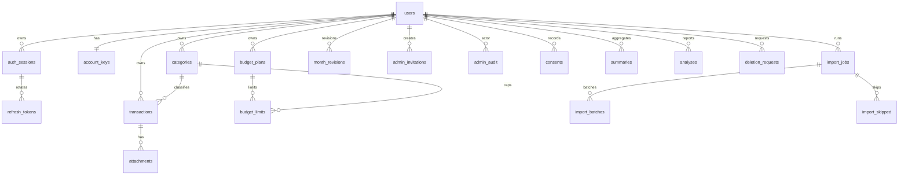

# PAM SRS v0.4 — versi review

Document ID: **PAM-SRS-001**
Versi: **v0.4 review draft** (21 November 2026)
Baseline: v0.2 + CR-001 (v0.3, disetujui) + CR-002 (v0.4, **belum disetujui penuh**)
Status: **DRAFT REVIEW** — cloud gratis disetujui pemilik; sign-off paket produk v0.4 belum tercatat.

Dokumen ini adalah konsolidasi requirement untuk paket B. Ia menggantikan pembacaan v0.2 yang
masih menyebut OAuth/Google Sign-In. Riwayat perubahan ada di §9; rancangan teknis ada di
[`10_MIGRASI_PEDOMAN.md`](10_MIGRASI_PEDOMAN.md); kontrak HTTP ada di
[`06_BACKEND_CONTRACT.md`](06_BACKEND_CONTRACT.md); traceability dan test plan ada di
[`01_SCOPE_TRACEABILITY.md`](01_SCOPE_TRACEABILITY.md).

---

## 1. Ringkasan produk dan batas

PAM merekap notifikasi **Livin by Mandiri** dan transaksi manual menjadi ringkasan arus kas IDR
bulanan yang deterministik, lalu — hanya dengan consent terpisah — analisis berbasis bukti dan
rencana anggaran bulan berikutnya.

**Di luar scope (tidak berubah):** API bank, saldo, transfer/perpindahan dana, OCR, penambahan
bank, klaim kelengkapan ledger, nasihat investasi/kredit/pajak, export, reminder, background sync
otomatis.

**Perubahan arah v0.4.** Transaksi, kategori, rencana anggaran, metadata lampiran dan import job
disimpan **server-side** pada Turso Cloud Free/libSQL melalui REST. Room/SQLCipher dihapus dari
varian penilaian. Aplikasi membutuhkan backend dan koneksi internet untuk CRUD dan pemuatan ulang
setelah restart. Email mentah tetap diproses di perangkat dan tidak pernah dikirim ke backend.

| Keputusan | Status |
|---|---|
| Cloud database gratis; MySQL baseline minimum, alternatif cloud diizinkan | **Disetujui pemilik** (21 Nov 2026) |
| Turso Cloud Free + engine libSQL | Pilihan lead, menunggu sign-off paket |
| Backend Go (`net/http`, `database/sql`, driver libSQL) | **Disetujui pemilik** (21 Nov 2026) |
| Transaksi server-side, offline terbatas, dua peran, lampiran lokal, lima CRUDS | **Diajukan** di v0.4, belum sign-off |
| Reset/migrasi data nyata, deployment publik, biaya berbayar | **Belum diotorisasi** |

---

## 2. Lokasi data dan mode operasi

| Data | Lokasi target | Catatan |
|---|---|---|
| Email mentah, subject, sender, UID/UIDVALIDITY | Hanya memori perangkat saat impor | Tidak dipersistenkan, tidak ke backend |
| Kredensial IMAP (App Password) | Vault Keystore perangkat | Tidak pernah ke backend/log |
| Baris transaksi, kategori, anggaran, metadata lampiran, import job | Turso/libSQL lewat REST | Owner dari sesi; field sensitif AES-GCM |
| File foto/PDF | Direktori privat per pemilik di perangkat | Server hanya metadata + referensi abstrak |
| Fingerprint impor | HMAC kunci per akun (server-held, disegel) | Stabil lintas reinstall/perangkat |
| Refresh token | Hash di server; material klien di Keystore | Rotasi atomik, reuse = cabut keluarga |
| Payload AI | Hanya proyeksi agregat yang diizinkan | FR-35/NFR-19 tetap mengikat |

**Mode operasi.**
- `ONLINE` — backend dan database terjangkau; semua CRUDS dan ringkasan tersedia.
- `DEGRADED_MAILBOX` — Gmail/IMAP gagal; data server yang sudah ada tetap terbaca, impor berhenti
  dengan state yang jelas (FR-07/NFR-22).
- `DEGRADED_AI` — model gagal; ringkasan dan CRUDS tetap berjalan, analisis `Unavailable`.
- `UNAVAILABLE` — backend/database tidak terjangkau; tampilkan state unavailable, pertahankan
  isian form yang belum terkirim; tidak ada klaim angka setengah jadi.

Mode offline penuh v0.3 **tidak lagi dijanjikan** untuk CRUD v0.4. Data lokal v0.3 tetap tersedia
pada APK lama selama cutover; rollback memerlukan rekonsiliasi transaksi v0.4 (lihat §8).

---

## 3. Peran

| Peran | Hak |
|---|---|
| `USER` | CRUD data miliknya sendiri, consent, impor, analisis, anggaran, lampiran. Tidak dapat melihat pengguna lain. |
| `ADMIN` | Semua hak `USER` untuk datanya sendiri + daftar/cari pengguna, buat undangan, ubah nama/peran/status, soft delete pengguna. Tidak dapat membaca transaksi pengguna lain. |

Register publik (kode undangan) selalu menghasilkan `USER`. `ADMIN` hanya melalui provisioning
terkontrol (CLI/ops) atau undangan satu-kali yang dibuat ADMIN yang sudah ada. Admin aktif terakhir
tidak dapat diturunkan atau dihapus. Perubahan peran/status mencabut sesi pengguna tersebut.

---

## 4. Functional requirements

Requirement v0.2 yang tidak berubah tetap mengikat dan tidak diulang seluruhnya di sini; tabel
berikut adalah **delta v0.4** dan requirement baru. Teks lengkap v0.2 tetap menjadi rujukan untuk
FR-01…FR-55 yang tidak disentuh.

### 4.1 Delta requirement

| ID | Teks target v0.4 |
|---|---|
| FR-02 | Setiap query/read/write/list/search/import/attachment/budget/deletion difilter berdasarkan owner dari sesi terverifikasi. Admin hanya mengakses data akun, bukan data keuangan pengguna lain. |
| FR-11–FR-15 | Matriks template memakai format Livin yang dibuktikan lewat MIME/HTML; label tanpa titik dua dan nilai di sel berikutnya didukung. Pembayaran tagihan hanya untuk template yang tervalidasi. |
| FR-35 | Payload ke penyedia AI hanya proyeksi agregat yang diizinkan, setelah consent. Merchant, catatan, deskripsi bebas, label kategori buatan pengguna dan atribut dinamis dikecualikan. Batas ini berlaku di backend sebelum pemanggilan model. |
| FR-52 | Mode akademik v0.4 memakai sesi backend dan database cloud. CRUD serta pemuatan setelah restart membutuhkan backend/database; mode fixture diberi label dan hanya untuk pengujian/demo. |
| FR-56 | Turso Cloud/libSQL menyimpan transaksi, kategori, rencana/batas anggaran, metadata lampiran, import job, akun, sesi, consent dan data backend existing. Token database, JWT secret, kunci enkripsi dan kunci fingerprint tetap di backend. |
| DR-02 | Fingerprint impor = HMAC-SHA256 dengan kunci per akun atas identifier pesan + field transaksi. Identifier mentah tidak disimpan; kunci disegel di server dan di-cache Keystore klien. |
| DR-04 | Revisi ringkasan, analisis dan rencana mengacu pada `month_revisions` dan `inputRevision` dari dataset server yang konsisten. |
| DR-05 | Backend hanya menyimpan record yang dinormalisasi dan field yang diperlukan; email mentah, lampiran email, kredensial mailbox dan identifier mentah dilarang. |
| NFR-06/07 | Target performa daftar/ringkasan diukur pada dataset cloud yang ditentukan; angka target dikunci sebelum performance test. Calculator deterministik tetap diuji terpisah. |
| NFR-15/16 | Retensi transaksi/atribut/attachment metadata/backup dinyatakan; AES-GCM payload dipertahankan dan diperluas ke field sensitif baru; refresh token dan file privat dilindungi perangkat. |
| NFR-19 | Allowlist payload AI ditegakkan di backend, termasuk kategori buatan pengguna dan atribut bebas. |
| NFR-21 | Impor idempoten dan atomik per batch; retry tidak menghidupkan kembali baris yang sudah dihapus dan tidak menduplikasi fingerprint. |
| NFR-22 | Availability backend ditargetkan dan diukur; kegagalan Gmail/AI tidak memblokir data server; kegagalan backend/database menghasilkan state unavailable. |
| NFR-23 | Backup terenkripsi harian + restore drill; PITR Free 24 jam; kunci dikembalikan terpisah; sesi yang dicabut setelah waktu backup tetap dicabut setelah restore. |
| NFR-27 | Layanan Go wajib memvalidasi request, membatasi body/timeout, menangani cancellation/graceful shutdown, error eksplisit tanpa panic input, logging terstruktur tanpa PII, dan migration/retry yang aman. |
| NFR-28 | Migrasi Go mempertahankan identitas akun, verifikasi password, format ciphertext, owner scope, migration re-entry dan kompatibilitas kontrak Android; parity Node↔Go dibuktikan sebelum cutover. |
| §1.4, §2, §4.3, App. B/C | Scope, aliran data, kontrak REST, diagram, notice privasi, open issue dan acceptance diperbarui untuk data server-side. |

### 4.2 Requirement baru

| ID | Teks |
|---|---|
| **FR-57** | Backend menerbitkan JWT access bertanda tangan dengan TTL ≤15 menit (klaim `iss`, `aud`, `sub`, `sid`, `role`, `ver`, `iat`, `exp`, `jti`), memverifikasi tanda tangan/klaim/masa berlaku, dan memeriksa sesi server. Refresh token opaque di-hash di server, dirotasi atomik, replay mencabut keluarga sesi. |
| **FR-58** | Peran `USER` dan `ADMIN` ditegakkan di UI dan server. Register publik → `USER`. Admin diprovisioning terkontrol/undangan. Admin dapat membuat/mengundang, mencari, mengubah dan menonaktifkan akun; admin aktif terakhir dilindungi. |
| **FR-59** | Pengguna dapat memilih file foto/PDF, menyalinnya ke penyimpanan privat per pemilik, membuka ulang, mengganti nama/atribut, mencari, dan menghapusnya. Server menyimpan metadata + referensi lokal abstrak; file tidak diunggah. |
| **FR-60** | Transaksi disimpan server-side melalui REST CRUDS, terikat owner. Setiap perubahan menaikkan revisi bulan dan menandai ringkasan/analisis dependen. Data transaksi mentah tidak dikirim ke model (FR-35/NFR-19). |
| **FR-61** | Minimal empat entitas terkait — transaksi, kategori, rencana anggaran, metadata lampiran — masing-masing memiliki field dinamis tervalidasi yang dapat diisi, disimpan, dibaca ulang, diedit, dan ditampilkan. |
| **FR-62** | Klien mengoordinasikan satu refresh untuk request paralel dan mengulang tiap request paling banyak sekali. Refresh gagal membawa ke pemulihan sesi sambil mempertahankan isian yang belum terkirim bila memungkinkan. |
| **FR-63** | Lima fitur CRUDS lengkap melalui Compose: transaksi, kategori, anggaran, lampiran, pengguna admin. Masing-masing mendukung Create, Read, Update, Delete, Search; create/invite admin dapat dijalankan dari UI admin. |
| **FR-64** | Kategori mendukung create/list/detail/update/delete/search owner-scoped di Compose dan REST. Kategori yang direferensikan dilindungi atau dipindahkan atomik; kategori bawaan mempertahankan kode aman untuk kalkulasi dan proyeksi AI. |
| **FR-65** | ADMIN memiliki create/invite, list/detail, update, soft-delete dan search akun dari UI mobile. USER mendapat 403 di endpoint admin. Deaktivasi mencabut akses/sesi. Admin aktif terakhir dilindungi dan eskalasi peran mandiri dilarang. |

### 4.3 Business rules (tidak berubah)

BR-01 bulan Asia/Jakarta `[awal, awal bulan berikutnya)`; BR-02 gross/classified; BR-03 refund
netting; BR-04 exact minor units; BR-05 `Complete` hanya berarti cakupan query; BR-06 sitasi metrik.
Tambahan operasional: amount minor > 0 dan ≤ `1_000_000_000_000_000` (< `Number.MAX_SAFE_INTEGER`).

---

## 5. Data model

Kolom kanonik dan DDL ada di [`10_MIGRASI_PEDOMAN.md`](10_MIGRASI_PEDOMAN.md). Prinsip:

- ID string stabil; `owner_id` di setiap tabel bisnis; composite foreign key
  `(owner_id, id)` mencegah referensi lintas pemilik.
- `UNIQUE(owner_id, fingerprint)` untuk idempoten impor.
- `month_id` (`YYYY-MM`) + `event_at_ms` untuk filter/pagination terindeks.
- JSON dinamis disimpan sebagai TEXT tervalidasi (`json_valid`) untuk data non-sensitif; field
  sensitif (label kategori, merchant, catatan, nama file, atribut) disegel AES-GCM per baris.
- Soft delete (`deleted_at`) untuk transaksi, kategori, lampiran dan pengguna (`status=DELETED`);
  baris soft-deleted tidak masuk daftar aktif/total dan tetap untuk retensi/audit.
- Rencana anggaran dihapus hard setelah konfirmasi; tidak memengaruhi total arus kas.

---

## 6. Privasi, pencarian dan AI

- **Enkripsi.** Payload ringkasan/analisis/anggaran existing tetap AES-256-GCM. Field sensitif baru
  memakai helper yang sama dengan AAD `purpose|ownerId|keyVersion`. Ciphertext tidak pernah
  difilter dengan `LIKE`.
- **Kolom terindeks.** `owner_id`, `month_id`, `event_at_ms`, `category_id`, `direction`, `source`,
  `deleted_at`, `fingerprint`, `transaction_id`, `status`, `role`, `token_hash`.
- **Pencarian teks.** `q` hanya boleh dengan satu bulan atau rentang ≤31 hari; backend mendekripsi
  halaman per halaman, memindai maksimum 2.000 baris, dan mengembalikan cursor + `truncated`.
  Pagination tidak boleh memakai offset setelah filter dekripsi.
- **AI.** Hanya total agregat dan total kategori bawaan yang dikirim. Kategori buatan pengguna
  dipetakan ke `OTHER_EXPENSE` tanpa label; merchant, catatan, atribut bebas dan nama file tidak
  pernah masuk payload. Validasi allowlist di backend sebelum provider dipanggil (NFR-19).
- **IMAP.** Tetap di perangkat, read-only, App Password di Keystore, tidak dikirim ke backend.
- **Fingerprint.** Kunci per akun dibuat saat registrasi, disegel di server, diambil klien setelah
  login dan disimpan Keystore. Kunci yang sama dipakai setelah reinstall/perangkat baru. Rotasi
  hanya dengan migrasi re-fingerprint; penghapusan akun menghancurkan kunci.

### 6.1 Teks notice privasi v0.4 (target, diterapkan saat C2)

> **Yang disimpan di server PAM.** Untuk akun Anda, PAM menyimpan baris transaksi, kategori,
> rencana anggaran, metadata lampiran, dan riwayat impor di database cloud PAM. Merchant, catatan,
> deskripsi, dan atribut bebas ikut tersimpan terenkripsi agar Anda dapat membukanya lagi di
> perangkat lain.
>
> **Yang tetap di perangkat ini.** Email mentah, subjek, pengirim, ID pesan, lampiran email, dan
> Sandi aplikasi Gmail tidak pernah dikirim ke server PAM. File foto/PDF yang Anda lampirkan hanya
> ada di perangkat tempat Anda memilihnya; perangkat lain hanya melihat metadatanya.
>
> **Yang dikirim ke penyedia AI.** Hanya total agregat bulanan dan total kategori bawaan setelah
> Anda memberi consent AI. Merchant, catatan, nama file, label kategori buatan Anda, dan atribut
> bebas tidak pernah masuk payload AI.
>
> **Penghapusan.** Menghapus akun menghapus data aktif dan metadata lampiran; salinan backup
> kedaluwarsa paling lama 30 hari. File lokal dihapus dari perangkat saat Anda menghapus lampiran.

Notice versi ini menggantikan teks v0.3 yang menyatakan seluruh baris transaksi tetap di perangkat.
Jangan menerapkan teks baru sebelum cutover C2 dan sign-off.

---

## 7. UI dan lima CRUDS

Perubahan UI target (detail di [`03_ARCHITECTURE.md`](03_ARCHITECTURE.md)):

- Login/register memakai sesi backend; tidak ada Google Sign-In.
- Overview/transactions memuat dari REST dengan state loading/empty/partial/error/unavailable.
- Editor transaksi, kategori, anggaran dan lampiran memiliki editor atribut key–value terbatas.
- Lampiran memakai Android document picker; file disalin ke direktori privat per pemilik.
- Layar **Admin** baru: daftar/cari pengguna, buat undangan, ubah peran/status, soft delete.
- Settings: sesi, consent, koneksi mailbox, retensi, hapus akun.

| Fitur | Create | Read | Update | Delete | Search |
|---|---|---|---|---|---|
| Transaksi | manual + impor | daftar/detail | kategori/catatan/atribut | soft delete satuan | deskripsi pada bulan/rentang ≤31 hari |
| Kategori | kategori pengguna | daftar/detail | label/warna/atribut | soft delete + reassign | nama (owner) |
| Anggaran | rencana bulan | daftar/detail | nominal/batas/atribut | hard delete | bulan/nama |
| Lampiran | pilih + salin file | buka ulang | nama/atribut | hapus file + metadata | nama (owner) |
| Pengguna admin | undangan/create | daftar/detail | nama/peran/status | soft delete + revoke | email/nama |

Dua puluh lima pemeriksaan demo (5 fitur × C/R/U/D/S) ada di
[`01_SCOPE_TRACEABILITY.md`](01_SCOPE_TRACEABILITY.md) §7.

---

## 8. Migrasi, cutover dan rollback

- Migrasi v0.4 bersifat **additive** di atas `schema_migrations` versi 1–2; baris v0.3 dipertahankan.
- Room/SQLCipher baru dihapus dari runtime/dependensi/skema setelah irisan C1–C2 dan D lulus.
- Data lokal v0.3 (sintetis) tidak dimigrasikan otomatis pada paket B. Cutover data nyata butuh
  persetujuan pemilik. Rollback ke v0.3 membuka dataset lama; transaksi v0.4 perlu export/rekonsiliasi.
- Backup: PITR 24 jam + export terenkripsi harian; kunci di luar dump; restore drill pada database
  terpisah; sesi yang dicabut setelah waktu backup tetap dicabut.
- Cloud acceptance **NOT RUN** sampai kredensial database uji tersedia. Uji lokal `file:` tidak
  membuktikan cloud.

---

## 9. Riwayat perubahan

| Versi | Tanggal | Perubahan | Status |
|---|---|---|---|
| v0.2 | 18 Nov 2026 | SRS awal (Gmail OAuth, Room lokal, backend agregat) | baseline |
| v0.3 / CR-001 | 20 Nov 2026 | IMAP + App Password, akun PAM, backend Turso agregat | disetujui owner |
| v0.4 / CR-002 review | 21 Nov 2026 | Cloud gratis disetujui; Turso/libSQL untuk transaksi server-side, JWT/refresh, peran, lima CRUDS, lampiran, field dinamis; Room keluar | **draft review, belum sign-off** |
| Go slice | 21 Nov 2026 | Backend Go disetujui; register/login/refresh/consent/summary/CRUD inti + interop Node↔Go | slicer berjalan |
| Paket B | 21 Nov 2026 | Konsolidasi SRS, kontrak API, DDL/migrasi lokal teruji, ERD, UI dan test plan | draft review |
| C1 lanjutan | 21 Nov 2026 | Go idempotensi create, canonical analysis/validator, consent/deletion race guard, usage/ceiling, import batch, deletion sweep, config produksi | lokal PASS; C2/D berikutnya |

Perubahan v0.3 → v0.4 yang belum disetujui penuh ditandai **diajukan** pada tabel keputusan §1.
Yang sudah disetujui hanyalah arah cloud database gratis.

### Bukti paket B

| Pemeriksaan | Status | Sumber |
|---|---|---|
| Android JVM | PASS | **240 tes**, 0 gagal; `assembleDebug`; lint 0 error |
| Backend Node (referensi) | PASS | `typecheck`, `build`, **124 tes**, 0 gagal (termasuk interop Go) |
| Backend Go (target) | PASS lokal | **42 tes Go**, `go test -race`, `go vet`, `go build` |
| Migrasi libSQL lokal | PASS | `file:` dari kosong, upgrade v0.3, boot kedua |
| Cloud Turso/engine/libSQL | NOT RUN | kredensial database uji belum tersedia |
| Gmail nyata / perangkat fisik | NOT RUN | di luar paket B |

---

## 10. Sign-off

| Peran | Nama | Keputusan | Tanggal |
|---|---|---|---|
| Owner | Andhika Pratama | arah cloud gratis; **paket v0.4 belum sign-off** | 21 Nov 2026 |
| Lead Developer | — | menyiapkan kontrak review | 21 Nov 2026 |

Sign-off penuh diperlukan sebelum aktivasi pada data pengguna, cutover, deployment publik, atau
penghapusan data nyata.
